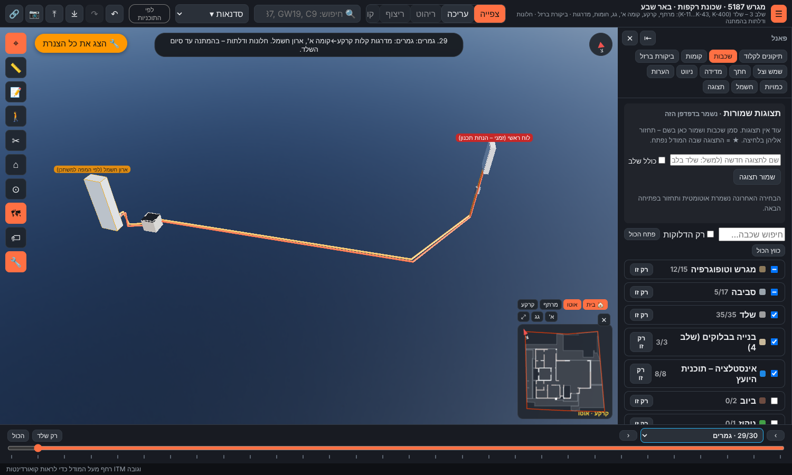
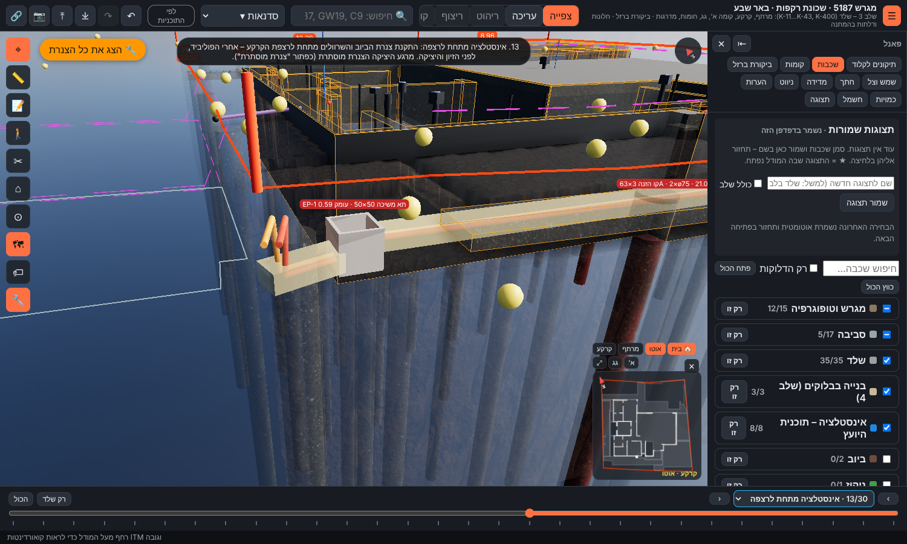
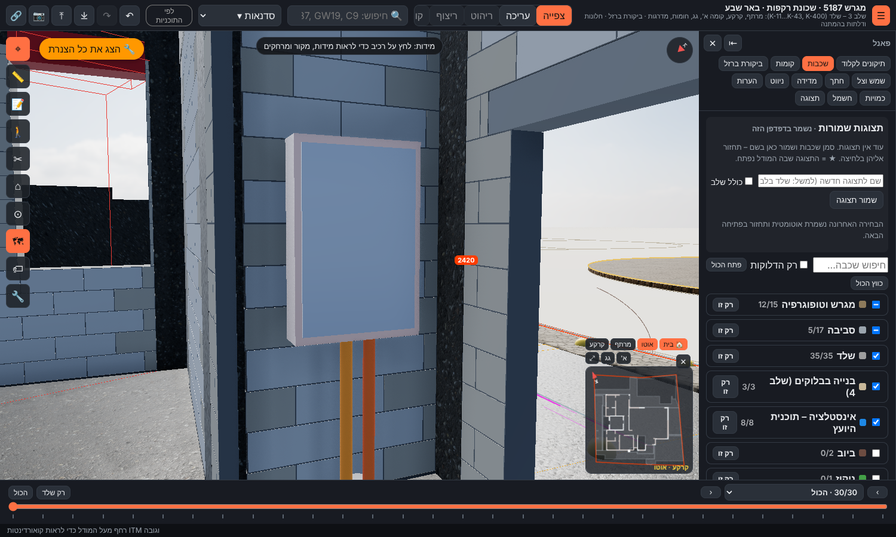

# ח1 – חיבור מהפילר ללוח הראשי (הצעה, עדכון 10.11.2026)

**מעמד:** הצעה לאישור אביחי. כל הערכים provisional.
- נתונים: `data/electrical/supply.json`, נוצר ע"י `python3 tools/electrical/propose_supply.py` מתוך `tools/electrical/supply-inputs.json`.
- מסמך זה נוצר ע"י `python3 tools/electrical/verify_supply.py`.
- במודל: לוח "חשמל" ← ח1 ← כפתור לכל שלב. השכבה: שכבות ← חשמל ← "הזנה ראשית".

> הסתייגות: תכנון מקדים לתיאום ולכמויות. ההגשה לחברת החשמל, חתך הכבל הסופי והחיבור – בידי חשמלאי בעל רישיון מתאים ובודק.

## 1. הרכיבים

| רכיב | מיקום | מפרט | מקור |
|---|---|---|---|
| ארון מונה | בפילר המערכות (חברת החשמל) | לפי הסימון בתוכנית הפיתוח | data/structure/stairs.json |
| תא משיכה EP-1 | רצפת חדר האשפה בפילר | פנים 0.5×0.5 מ', עומק 0.59 מ', מכסה B125 | הנחת תכנון |
| קו הזנה | תת-קרקעי, 20.96 מ' | N2XY 5×16 ממ"ר נחושת בצינור ø75, ועוד צינור ø75 שמור; חוט משיכה בכל צינור (גם בשמור), ופקק בקצוות עד משיכת הכבל | הנחת תכנון |
| שרוול ES-1 | ברצפת הקרקע GS1 מתחת לנישה | 2×ø110 | הנחת תכנון |
| שרוול ES-2 | בקיר האחורי של ארון המונה | 2×ø110 | הנחת תכנון |
| לוח ראשי | בנישה מימין לדלת הכניסה (קיר BK-G27) | 0.8×1.2×0.2 מ', תחתית +0.90 | מיקום: אביחי (אושר). מידות: הנחת תכנון |

## 2. סדר הביצוע (שלב אחר שלב)

| # | שלב | שלב במודל | מה עושים |
|---|---|---|---|
| 1 | חפירת תעלה | `underSlab` | אחרי המילוי החוזר סביב המרתף, יחד עם תעלות קורות היסוד: חופרים תעלה ברוחב 45 ס"מ עד ‎-1.69, מהפילר ועד מתחת לנישת הלוח |
| 2 | צנרת, חול ותא משיכה | `underSlabPlumbing` | מצע חול 10 ס"מ, 2 צינורות ø75 עם חוט משיכה, חול 10 ס"מ מעל; מציבים את תא המשיכה; קשתות העלייה מתחת לנישת הלוח ובחדר האשפה. ממלאים ומהדקים – לפני הפוליביד והיציקה |
| 3 | שרוול ברצפה (ES-1) | `groundSlab` | השרוולים ברצפת הקרקע מתחת לנישה – בזיון הרצפה, לפני היציקה. מהיציקה הצנרת מוסתרת |
| 4 | פילר וארון המונה (ES-2) | `perimeterWalls` | עם בניית הפילר: שרוול בקיר האחורי של ארון המונה, והצינור עולה בפינת חדר האשפה |
| 5 | מכסה תא המשיכה וסרט סימון | `development` | בפיתוח: מגביהים את התא לפני הריצוף / הגינה, מכסה B125 |
| 6 | לוח ראשי ומשיכת כבל | `finishes` | אחרי טיח בנישה: מתקינים את ארגז הלוח, מושכים את הכבל בשני קטעים (ארון ← תא ← לוח), מחברים, בדיקת בודק, וחברת החשמל מתקינה מונה ומחברת |

## 3. למה תא משיכה

בגרסה הקודמת היה קטע משיכה אחד עם כ-500° כיפופים. כבל 5×16 לא נמשך דרך צינור כזה בפועל. הכלל המקובל הוא עד 270° בין שתי נקודות משיכה.

| קטע משיכה | אורך (מ') | כיפופים (°) | מול 270° |
|---|---|---|---|
| ארון המונה ← תא המשיכה | 2.48 | 180.0 | תקין |
| תא המשיכה ← לוח ראשי | 18.49 | 236.8 | תקין |

**מיקום התא:** החיפוש עבר על כל השטח ליד הפילר. מחוץ לפילר אין מקום פנוי: הרצפות התלויות GS4/GS5, החומה המערבית ויסודה וקווי המים ממערכת המדידה. לכן התא ברצפת חדר האשפה של הפילר, מאחורי ארון המונה, והוא מורחק 0.66 מ' מכלונס 115. ראש התא במפלס הרחוב 279.35 (זמני, עד פרט הפילר), ולכן עומקו רק 0.59 מ'. **לאישורך – E14.**

## 4. התעלה

רוחב 45 ס"מ, תחתית 278.81, חול עד 279.09, סרט סימון ב-279.29 (בחצר הפתוחה).

| קטע | עומק (מ') | חופרים מ- | למה |
|---|---|---|---|
| 1 | 0.54 | 279.35 | רצפת חדר האשפה (זמני) |
| 2 | 0.54 | 279.35 | רצפת חדר האשפה (זמני) |
| 3 | 0.83 | 279.64 | מתחת לרצפה GS4: תחתית הרצפה -0.56 פחות 0.30 (פוליביד 25 + בטון רזה 5) |
| 4 | 0.99 | 279.80 | מתחת לרצפה GS8: תחתית הרצפה -0.40 פחות 0.30 (פוליביד 25 + בטון רזה 5) |

## 5. ממצאים שקבעו את התוואי

1. **אין גישה לצנרת אחרי היציקה.** כל החצר הקדמית היא רצפות תלויות על קורות יסוד, ולכן הצנרת מונחת לפני היציקות. זו הסיבה לצינור השמור.
2. **הצינור יורד מתחת לביוב.** קווי הביוב חוצים את התוואי ברום 279.16–279.35, ולכן ציר הצינור ב--1.55 (278.95), מתחת לביוב ולקורות.
3. **כלונס 115 נמצא מתחת לארון המונה.** הכניסה לארון מהגב, דרך חדר האשפה. זמני עד פרט הפילר.
4. **הכניסה ללוח באלכסון.** במקום שני כיפופים של 90° יש כיפוף אחד של כ-57°. הכיפוף עובר בין כלונסאות 11 ו-12 ומחוץ לקו המרתף.
5. **שרוול ES-1 צמוד לקורה B-49.** דורש אישור הקונסטרוקטור.

## 6. נקודות התוואי

| # | E | N | H | יחסי ל-±0.00 |
|---|---|---|---|---|
| 0 | 179584.752 | 576236.326 | 279.650 | -0.85 |
| 1 | 179585.196 | 576236.890 | 279.650 | -0.85 |
| 2 | 179585.196 | 576236.890 | 278.950 | -1.55 |
| 3 | 179586.250 | 576236.800 | 278.950 | -1.55 |
| 4 | 179586.377 | 576237.114 | 278.950 | -1.55 |
| 5 | 179596.865 | 576232.878 | 278.950 | -1.55 |
| 6 | 179600.467 | 576235.386 | 278.950 | -1.55 |
| 7 | 179600.467 | 576235.386 | 281.400 | +0.90 |

0–1: כניסה לארון דרך הקיר האחורי. 2: ירידה בחדר האשפה. 3: תא המשיכה. 4–6: לאורך החזית ובאלכסון. 7: עלייה ללוח.

## 7. טבלת אימות – מרווחים (30 בדיקות, 0 נכשלו)

| סוג | רכיב | מרווח (מ') | נדרש (מ') | תוצאה | הערה |
|---|---|---|---|---|---|
| כלונס | כלונס 115 | 0.234 | 0.1 | תקין | מרחק אופקי משפת הכלונס |
| גבול מגרש | גבול המגרש | 0.337 | 0.1 | תקין | כל התוואי בתוך המגרש |
| כלונס | כלונס 10 | 0.493 | 0.1 | תקין | מרחק אופקי משפת הכלונס |
| כלונס | כלונס 11 | 0.141 | 0.1 | תקין | מרחק אופקי משפת הכלונס |
| כלונס | כלונס 16 | 0.873 | 0.1 | תקין | מרחק אופקי משפת הכלונס |
| שוחה | S-1 | 0.522 | 0.3 | תקין | מרחק אופקי מדופן השוחה |
| שוחה | S-4 | 0.621 | 0.3 | תקין | מרחק אופקי מדופן השוחה |
| מרתף | קירות המרתף (קו חוץ) | 0.409 | 0.4 | תקין | מרחק אופקי מקו החוץ של קירות המרתף |
| קורת יסוד | B-48 | 0.442 | 0.1 | תקין | תחתית קורה -1.07; ראש הצינור -1.51 |
| קורת יסוד | B-42 | 0.602 | 0.1 | תקין | תחתית קורה -0.91; ראש הצינור -1.51 |
| קורת יסוד | B-56 | 0.452 | 0.1 | תקין | תחתית קורה -1.06; ראש הצינור -1.51 |
| קורת יסוד | B-58 | 0.442 | 0.1 | תקין | תחתית קורה -1.07; ראש הצינור -1.51 |
| יסוד / תחתית קיר | PF1 | 0.712 | 0.1 | תקין | תחתית יסוד החומה -0.80 |
| יסוד / תחתית קיר | PF6 | 0.712 | 0.1 | תקין | תחתית יסוד החומה -0.80 |
| יסוד / תחתית קיר | קירות הפילר | 0.363 | 0.1 | תקין | תחתית קירות הפילר -1.15 (זמנית – פרט הפילר חסר) |
| צינור ביוב | SW4@ground | 0.285 | 0.1 | תקין | ø110 sewage, רום תחתית בחצייה 279.273; הצינור עובר מתחת |
| צינור ביוב | SW5@ground | 0.169 | 0.1 | תקין | ø110 sewage, רום תחתית בחצייה 279.156; הצינור עובר מתחת |
| צינור ביוב | SW7@ground | 0.245 | 0.1 | תקין | ø160 sewage, רום תחתית בחצייה 279.232; הצינור עובר מתחת |
| דופן קורה | B-49 (מתחת לקיר הלוח) | 0.054 | 0.0 | תקין | העלייה דרך הרצפה צמודה לדופן הקורה – בלי לחדור לקורה |
| תא משיכה – כלונס | כלונס 115 | 0.662 | 0.1 | תקין | תא המשיכה – מרחק אופקי מדופן התא |
| תא משיכה – צינור ביוב | CW1@ground | 0.294 | 0.15 | תקין | תא המשיכה – מרחק אופקי מדופן התא |
| תא משיכה – צינור ביוב | CW6@ground | 0.293 | 0.15 | תקין | תא המשיכה – מרחק אופקי מדופן התא |
| תא משיכה – צינור ביוב | CW7@ground | 0.293 | 0.15 | תקין | תא המשיכה – מרחק אופקי מדופן התא |
| תא משיכה – wall | PF1 | 0.348 | 0.05 | תקין | תא המשיכה – מרחק אופקי מדופן התא |
| תא משיכה – wall | PF5 | 0.671 | 0.05 | תקין | תא המשיכה – מרחק אופקי מדופן התא |
| תא משיכה – wall | PF6 | 0.2 | 0.05 | תקין | תא המשיכה – מרחק אופקי מדופן התא |
| תא משיכה – wall | קירות הפילר | 0.195 | 0.05 | תקין | תא המשיכה – מרחק אופקי מדופן התא |
| תא משיכה – גבול מגרש | גבול המגרש | 1.001 | 0.1 | תקין | תא המשיכה – מרחק אופקי מדופן התא |
| משיכת כבל (°) | ארון המונה ← תא המשיכה | 90.0 | 0 | תקין | כיפופים 180.0° מתוך 270° מותרים (הערך במעלות) |
| משיכת כבל (°) | תא המשיכה ← לוח ראשי | 33.2 | 0 | תקין | כיפופים 236.8° מתוך 270° מותרים (הערך במעלות) |

המרווחים הנדרשים הם ערכי תכנון (`minClear`, `pullPit.clear` בקובץ הקלט), לא דרישת תקן.

## 8. כמויות מקדמיות

| פריט | כמות |
|---|---|
| צינור שרשורי ø75 | 42 מ' (2 צינורות) |
| כבל N2XY 5×16 ממ"ר נחושת | 25 מ' |
| חוט משיכה | 42 מ' |
| תא משיכה 0.5×0.5 + מכסה B125 | 1 |
| שרוולים ø110 | 4 |
| חפירת תעלה | 17.1 מ' אורך |
| סרט סימון | לאורך הקטעים בחצר הפתוחה |

## 9. פתוח לאישור

| # | נושא |
|---|---|
| E1 | גודל חיבור 3×63A |
| E8 | פרט הפילר, מידות ארון המונה ומפלס רצפת חדר האשפה – קובעים את קצה הפילר ואת ראש התא |
| E11 | אישור הקונסטרוקטור: שרוול ES-1 ליד B-49, ומעבר הצנרת מתחת לקורות ולתחתית קירות הפילר |
| E12 | מידות הלוח הראשי (אחרי טבלת המעגלים, ח7). הנישה כ-1.40 מ' רוחב |
| E14 | **חדש:** תא משיכה ברצפת חדר האשפה של הפילר (אין מקום פנוי מחוץ לפילר) |
