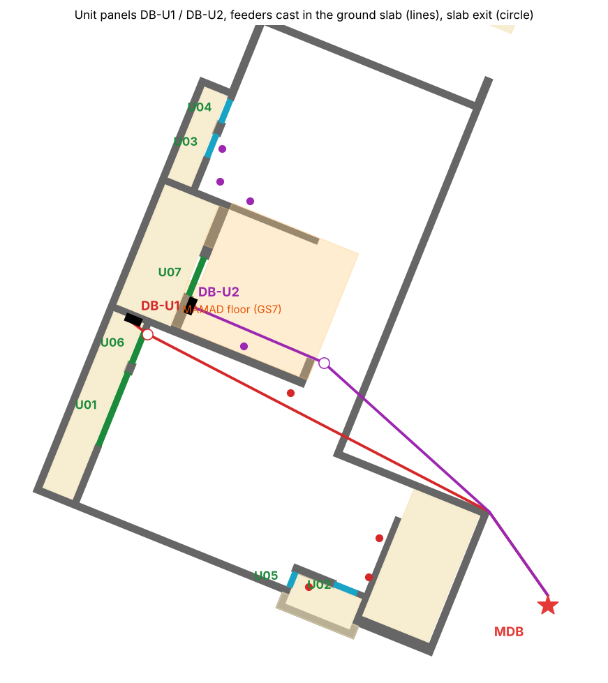
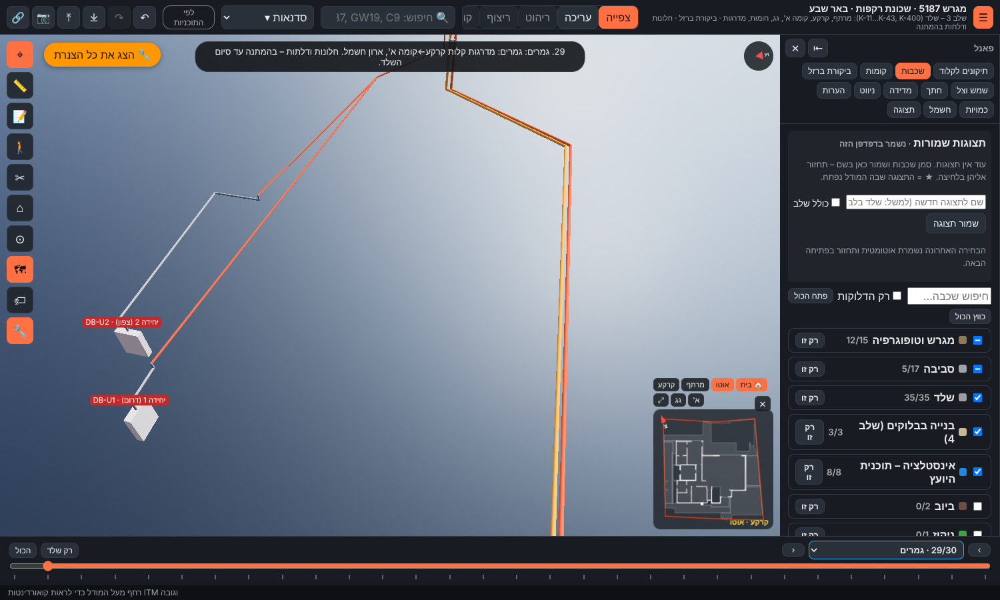

# ח1ב – לוח לכל יחידת דיור במרתף (הצעה, 10.11.2026)

**מעמד:** הצעה לאישור אביחי. כל הערכים provisional.
- נתונים: `data/electrical/units.json`, נוצר ע"י `python3 tools/electrical/propose_units.py` (קלט: `tools/electrical/units-inputs.json`).
- מסמך זה: `python3 tools/electrical/verify_units.py`.
- במודל: לוח "חשמל" ← ח1ב.

**החלטות אביחי (10.11.2026):** לוח נפרד לכל יחידה; הכניסה ליחידה 1 דרך U06 וליחידה 2 דרך U07; מוני המשנה בלוח הראשי בכניסה.




## 1. מבנה

```
לוח ראשי (MDB, בנישה בכניסה)
  ├ מא"ז 3×25A → מונה משנה SM-U1 → כבל N2XY 5×6 ממ"ר נחושת → DB-U1 (יחידה 1)
  └ מא"ז 3×25A → מונה משנה SM-U2 → כבל N2XY 5×6 ממ"ר נחושת → DB-U2 (יחידה 2)
```
- מונה משנה: מונה משנה דיגיטלי תלת-פאזי MID על פס DIN, 4 מודולים כל אחד, בלוח הראשי (MDB) בכניסה.
- לוח יחידה: 36 מודולים, על הטיח. כולל מפסק ראשי, ממסר פחת, כ-8–10 מעגלים (תאורה, שקעים, מטבח, מזגן, דוד) ומקום שמור.

## 2. מיקום וההזנה

| לוח | יחידה | פתח כניסה | מרחק מהפתח (מ') | תחתית / ראש | ביציקה (מ') | גלוי ביחידה (מ') | סה"כ (מ') | כבל (מ') |
|---|---|---|---|---|---|---|---|---|
| DB-U1 | יחידה 1 (דרום) | U06 (דלת, אדן +0.00 מעל הרצפה) | 0.71 | 279.10 / 279.70 | 12.67 | 0.65 | 15.02 | 17 |
| DB-U2 | יחידה 2 (צפון) | U07 (חלון הזזה, אדן +1.30 מעל הרצפה) | 0.79 | 279.10 / 279.70 | 8.44 | 4.50 | 14.64 | 17 |

- **ביציקה:** צינור ø40 ברצפת הקרקע GS1, שהיא גם תקרת המרתף. ציר הצינור ב-280.17, כלומר 5 ס"מ כיסוי מעל תחתית התקרה (280.10). הצינור קשור לרשת הברזל התחתונה ומונח לפני היציקה.
- **לא עובר** בפיר המדרגות, בחצרות האנגליות, בפתחי הרצפה או ברצפת הממ"ד (GS7). המרווח הנדרש מכל אחד מהם הוא 20 ס"מ.
- **ביחידה:** הצינור יוצא מתחתית התקרה ויורד ללוח: יציאה מתחתית התקרה מעל הלוח, ירידה גלויה בתעלה (או במחיצה לפי הסקיצה) עד ראש הלוח.

## 3. ממצאים לבדיקה

1. **U07 הוא חלון ולא דלת (E16).** בתוכניות זה חלון הזזה 80×80 באדן +1.30 מעל רצפת המרתף. החצר האנגלית שמולו במפלס ‎-1.50, כלומר 1.10 מ' מעל רצפת היחידה. כדי שישמש ככניסה צריך שינוי פתח לדלת ומדרגות בחצר. כנראה זה מה שמופיע בסקיצה. **לאשר.**
2. **הלוח של יחידה 2 נמצא מתחת לרצפת הממ"ד (E17).** הנחתי שאסור להטמין צנרת ברצפת הממ"ד, לפי ההנחיות על מעטפת הממ"ד, וזה דורש אימות. לכן הצינור יוצא מתחתית התקרה מחוץ לממ"ד ורץ גלוי בפינת התקרה והקיר, 4.5 מ', עד הלוח. האפשרויות:
   - לאשר את הקטע הגלוי (הצינור מוצמד בתפסים לתחתית רצפת הממ"ד; לבדוק מול הנחיות פיקוד העורף);
   - להזיז את DB-U2 לקיר מחוץ לתחום הממ"ד, רחוק יותר מהכניסה, ואז הצינור כולו ביציקה.
3. **יציאת הצינור של יחידה 2 צמודה לקצה הקיר שבין היחידות.** בגלל זה הקטע הגלוי עלול לעבור ביחידה 1. הקירות הפנימיים של הסקיצה לא נמצאים בסביבה, ולכן צריך לבדוק מולה (E18).
4. **לוח יחידה 1** נמצא על פני הקיר שבין היחידות, 0.71 מ' מ-U06, בצד של יחידה 1. מדרום ל-U06 יש חלון U01, ולכן אין שם קיר פנוי.

## 4. סדר הביצוע

| # | שלב | שלב במודל | מה עושים |
|---|---|---|---|
| 1 | צנרת ביציקת רצפת הקרקע | `groundSlab` | צינור ø40 מהלוח הראשי לכל יחידה, קשור לרשת התחתונה של רצפת הקרקע; קצה עם קופסה / שרוול בתחתית התקרה מעל מקום הלוח. לפני היציקה |
| 2 | מחיצות היחידות | `blockWalls` | לפי הסקיצה: אם יש מחיצה ליד הכניסה – הירידה בתוכה; אחרת תעלה גלויה |
| 3 | לוח, כבל ומונה משנה | `finishes` | התקנת לוח 36 מודולים בכל יחידה ליד הכניסה, משיכת כבל 5×6 מהלוח הראשי, מונה משנה תלת-פאזי בלוח הראשי לכל יחידה, בדיקת בודק |

## 5. טבלת אימות (26 בדיקות, 0 נכשלו)

| בדיקה | מרווח (מ') | נדרש (מ') | תוצאה | הערה |
|---|---|---|---|---|
| DB-U1 – מרחק מפתח קרוב | 9 | 0.15 | תקין | מרחק הלוח מפתח U06: 0.71 מ' (מרכז למרכז) |
| DB-U1 – על קיר המרתף לכל רוחבו | 1 | 0 | תקין | הלוח כולו על קיר (לא חורג מפינה או מפתח) |
| DB-U1 – בתוך היחידה | 1 | 0 | תקין | צד הלוח הרחוק בתוך המרתף |
| DB-U1 – גינה | 10.819 | 0.199 | תקין | מרחק אופקי של הצינור ביציקה מפתח / ממ"ד |
| DB-U1 – חצר אנגלית (רשת מדרך) | 4.006 | 0.199 | תקין | מרחק אופקי של הצינור ביציקה מפתח / ממ"ד |
| DB-U1 – מדרגות ירידה למרתף | 0.273 | 0.199 | תקין | מרחק אופקי של הצינור ביציקה מפתח / ממ"ד |
| DB-U1 – חצר אנגלית (רשת מדרך) | 0.4 | 0.199 | תקין | מרחק אופקי של הצינור ביציקה מפתח / ממ"ד |
| DB-U1 – פיר מדרגות (פתח ברצפה) | 0.219 | 0.199 | תקין | מרחק אופקי של הצינור ביציקה מפתח / ממ"ד |
| DB-U1 – חצר אנגלית (רשת מדרך) | 3.583 | 0.199 | תקין | מרחק אופקי של הצינור ביציקה מפתח / ממ"ד |
| DB-U1 – ממ"ד | 0.468 | 0.199 | תקין | מרחק אופקי של הצינור ביציקה מפתח / ממ"ד |
| DB-U1 – פתח ברצפה | 0.377 | 0.199 | תקין | מרחק אופקי של הצינור ביציקה מפתח / ממ"ד |
| DB-U1 – פתח ברצפה | 4.006 | 0.199 | תקין | מרחק אופקי של הצינור ביציקה מפתח / ממ"ד |
| DB-U1 – פתח ברצפה | 0.337 | 0.199 | תקין | מרחק אופקי של הצינור ביציקה מפתח / ממ"ד |
| DB-U2 – מרחק מפתח קרוב | 9 | 0.15 | תקין | מרחק הלוח מפתח U07: 0.79 מ' (מרכז למרכז) |
| DB-U2 – על קיר המרתף לכל רוחבו | 1 | 0 | תקין | הלוח כולו על קיר (לא חורג מפינה או מפתח) |
| DB-U2 – בתוך היחידה | 1 | 0 | תקין | צד הלוח הרחוק בתוך המרתף |
| DB-U2 – גינה | 10.745 | 0.199 | תקין | מרחק אופקי של הצינור ביציקה מפתח / ממ"ד |
| DB-U2 – חצר אנגלית (רשת מדרך) | 6.146 | 0.199 | תקין | מרחק אופקי של הצינור ביציקה מפתח / ממ"ד |
| DB-U2 – מדרגות ירידה למרתף | 4.555 | 0.199 | תקין | מרחק אופקי של הצינור ביציקה מפתח / ממ"ד |
| DB-U2 – חצר אנגלית (רשת מדרך) | 3.893 | 0.199 | תקין | מרחק אופקי של הצינור ביציקה מפתח / ממ"ד |
| DB-U2 – פיר מדרגות (פתח ברצפה) | 0.233 | 0.199 | תקין | מרחק אופקי של הצינור ביציקה מפתח / ממ"ד |
| DB-U2 – חצר אנגלית (רשת מדרך) | 3.733 | 0.199 | תקין | מרחק אופקי של הצינור ביציקה מפתח / ממ"ד |
| DB-U2 – ממ"ד | 0.348 | 0.199 | תקין | מרחק אופקי של הצינור ביציקה מפתח / ממ"ד |
| DB-U2 – פתח ברצפה | 0.357 | 0.199 | תקין | מרחק אופקי של הצינור ביציקה מפתח / ממ"ד |
| DB-U2 – פתח ברצפה | 6.146 | 0.199 | תקין | מרחק אופקי של הצינור ביציקה מפתח / ממ"ד |
| DB-U2 – פתח ברצפה | 4.537 | 0.199 | תקין | מרחק אופקי של הצינור ביציקה מפתח / ממ"ד |

"מרחק מפתח קרוב = 9" פירושו שאין פתח על אותו קטע קיר. המרווחים הנדרשים הם ערכי תכנון, לא דרישת תקן.

## 6. תוואים (E, N יחסית ל-179500 / 576200; H יחסית ל-±0.00)

| קו | נקודות |
|---|---|
| FD-UNIT1 | (100.62, 35.59, +0.90) → (100.62, 35.59, -0.33) → (99.08, 37.78, -0.33) → (90.23, 42.43, -0.33) → (90.23, 42.43, -0.44) → (89.72, 42.63, -0.44) → (89.76, 42.73, -0.44) → (89.76, 42.73, -0.80) |
| FD-UNIT2 | (100.62, 35.59, +0.90) → (100.62, 35.59, -0.33) → (99.08, 37.78, -0.33) → (94.23, 40.89, -0.33) → (94.23, 40.89, -0.44) → (94.60, 41.82, -0.44) → (91.36, 43.13, -0.44) → (91.36, 43.13, -0.80) |

## 7. פתוח

| # | נושא |
|---|---|
| E15 | הזנה תלת-פאזית 3×25A (5×6 ממ"ר) לכל יחידה – לפי העומס הסופי של היחידה |
| E16 | U07 ככניסה ליחידה 2: שינוי חלון לדלת ומדרגות בחצר האנגלית |
| E17 | צנרת מתחת לרצפת הממ"ד: לאשר קטע גלוי, או להזיז את DB-U2 |
| E18 | הקירות הפנימיים של היחידות – הסקיצה לא נמצאת בסביבה; לבדוק את התוואי הגלוי מולה |
