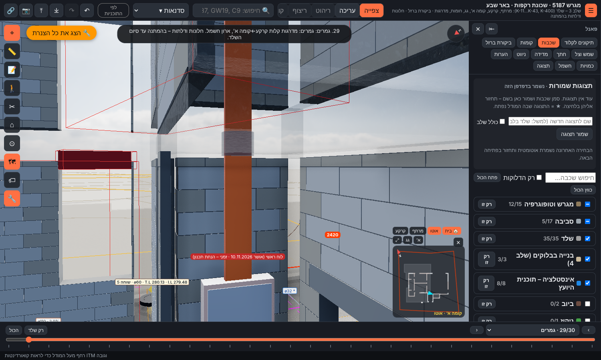
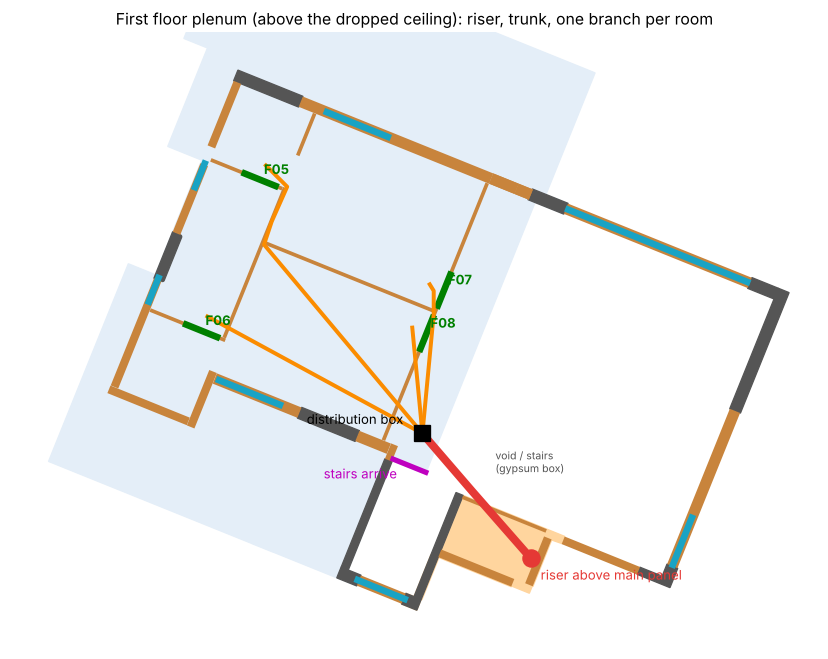
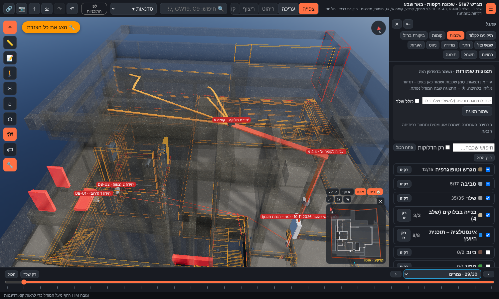

# ח1ג – מעגלי קומה א' מהלוח הראשי: עלייה מעל הלוח וחלוקה בהנמכה (הצעה, 13.11.2026)

**מעמד:** הצעה לאישור אביחי. גובה ההנמכה זמני.
- נתונים: `data/electrical/first-riser.json`, נוצר ע"י `python3 tools/electrical/propose_first_riser.py` (קלט: `tools/electrical/first-riser-inputs.json`).
- מסמך זה: `python3 tools/electrical/verify_first_riser.py`.

**ההחלטה (אביחי, 13.11.2026):** אביחי 13.11.2026: אין לוח משנה בקומה א'; כל מעגל של קומה א' מהלוח הראשי. התוואי: עולה מעל הלוח לחלל, עובר בחלל עד גובה הנמכת התקרה, עובר בה ומחלק לכל חדר.

## 1. למה זה עובד (תיקון להסבר הקודם)

- **קורה B-25** יושבת בראש קיר הנישה, והפנים שלה מיושרים עם פני הקיר. צרור שעולה **לפני הקיר**, בתוך ארון הנגרות, עובר לידה בלי לחדור לקורה. היא חוסמת רק צנרת שעוברת בתוך הקיר.
- **מעל הנישה** יש את הרצפה FS2 (284.20 (+3.70)). החדירה דרכה היא בשרוולים ברצפה, לא בקורה. FS2 נמצא מתחת לתקרת הגג, כלומר בתוך הבית.
- מעל FS2 ומסביבו יש חלל (המדרגות והגובה הכפול). הצרור **ממשיך לעלות בחלל עד גובה החלל הטכני שמעל ההנמכה**, ושם עובר אל קומה א'.

## 2. מפלסים

| מה | רום | מקור |
|---|---|---|
| ראש הלוח הראשי | 282.60 (+2.10) | ח1 |
| רצפה FS2 (עליון / תחתון) | 284.20 (+3.70) / 284.00 (+3.50) | K-31 |
| רצפה גמורה קומה א' | 284.35 (+3.85) | sources/architecture/חתך א-א – מפלסים ‎-2.60 / 0 / +3.85 (sources/README.md) |
| **הנמכת תקרה – 35 ס"מ (ניתן לשינוי)** | 286.80 (+6.30) | החלטת אביחי 13.11.2026: הנמכה של 35 ס"מ מתחת לתקרה היצוקה (כמו בקומת הקרקע), עם אפשרות לשינוי בהמשך. לשינוי – לעדכן את depth_m כאן ולהריץ מחדש את propose_first_riser.py: הגובה, מיקום המזגן והבדיקות מתעדכנים. במקורות אין הנמכה בקומה א' (חתך א-א: רצפה ‎+3.85, תחתית הבטון ‎+6.65) |
| גובה נטו מתחת להנמכה | 2.45 מ' | רצפה גמורה עד ההנמכה |
| רצפה גמורה עד התקרה היצוקה | 2.80 מ' | ‎+3.85 עד תחתית תקרת הגג |
| תוואי הצרור | 287.11 (+6.61) | 12 ס"מ מתחת לתקרת הגג |
| תחתית תקרת הגג | 287.15 (+6.65) | K-41 |

## 3. התוואי

- **עלייה:** 4.51 מ' מראש הלוח. בתוך ארון הנגרות עד התקרה, שרוולים ברצפה FS2, ומעליה תעלה סגורה לאורך הקיר BK-F83 עד החלל הטכני.
- **צרור בחלל הטכני:** 4.29 מ' עד תיבת חלוקה בהנמכת המסדרון, ליד ראש המדרגות. מתוכם **1.88 מ' מעל החלל**, ושם צריך סינר גבס. פתח בקיר בלוקים: BK-F84.
- **צנרת:** כ-16–20 צינורות ø20 / ø25 (מריכף). הכמות המדויקת לפי טבלת המעגלים (ח7). בעלייה – בתוך ארון הנגרות ובתעלה סגורה; בחלל הטכני – מגש / צרור קשור לתקרה.

| הסתעפות לדלת | חדר | אורך (מ') | פתחים בקירות בלוקים |
|---|---|---|---|
| F05 | דלת חד כנפית - 86_210 | 8.79 | BK-F58 |
| F06 | דלת חד כנפית - 86_210 | 6.35 | BK-F55, BK-F58 |
| F07 | דלת חד כנפית - 86_210 | 3.91 | BK-F58 |
| F08 | דלת חד כנפית - 86_210 | 2.76 | BK-F58 |

ההסתעפויות סכמטיות ומגיעות עד פנים החדר. החלוקה לנקודות בתוך כל חדר תיקבע בשלב הנקודות (ח4).

## 3א. מיני-מרכזי – מקום שמור

- **מקום שמור ליחידה פנימית – מיני-מרכזי קומה א':** 1.3×0.75×0.3 מ', 2.5 מ' מתיבת החלוקה. תחתית 286.83, ראש 287.13, כלומר 3 ס"מ מעל ההנמכה. מרחק בתוכנית מצנרת החשמל: 0.17 מ'.
- נפח שמור (לא יחידה שנבחרה): יחידה פנימית מתועלת (ducted) לקומה א', כ-1.3×0.75×0.30 מ'. צריך פתח שירות בהנמכה מתחת ליחידה, ניקוז בשיפוע לקולטן / לנקז, צנרת גז לעבה בגג, ונקודת חשמל + פיקוד ליד היחידה. לא מתחת לצנרת החשמל בתוכנית (מרחק ≥15 ס"מ), ולכן היחידה יכולה לעלות עד 2 ס"מ מהתקרה. בהנמכה של 35 ס"מ נדרשת יחידה דקה – עד כ-30 ס"מ
- חשמל למזגן: נקודת כוח למזגן מהלוח הראשי (מעגל נפרד – מא"ז לפי ההספק שייבחר, לרוב 1×25A או 3×16A) + צינור פיקוד לתרמוסטט

## 4. סדר הביצוע

| # | שלב | שלב במודל | מה עושים |
|---|---|---|---|
| 1 | שרוולים ברצפת FS2 | `groundCeiling` | צרור שרוולים ברצפה FS2 מעל הלוח, לפני יציקת תקרת הקרקע; צמוד לפני הקיר – ליד קורה B-25, לא דרכה |
| 2 | נקודות תלייה בתקרת הגג | `firstCeiling` | עוגנים / פסי תלייה בתקרת הגג לאורך התוואי (או התקנה בקידוח אחרי היציקה) |
| 3 | פתחים בקירות הבלוקים | `blockWalls` | פתח מעל גובה ההנמכה בכל קיר בלוקים שהתוואי חוצה |
| 4 | צנרת, סינר גבס והנמכה | `finishes` | העלייה בתוך ארון הנגרות ובתעלה סגורה ב-FS2, הצרור בחלל הטכני, סינר גבס מעל החלל, הסתעפות לכל חדר, משיכת כבלים; אחר כך סגירת ההנמכה |

## 5. בדיקות

| בדיקה | ערך | נדרש | תוצאה | הערה |
|---|---|---|---|---|
| קורה B-25 – הצרור עולה לפניה | 0.099 | 0.0 | תקין | מרחק ציר הצרור מפני הקורה (הצרור צמוד לפני הקיר, הקורה מיושרת עם פני הקיר) |
| חלל טכני מעל ההנמכה | 0.35 | 0.32 | תקין | גובה זמני – E20 |
| התוואי לא חוצה קירות בטון | 1 | 0 | תקין | אכיפה בחיפוש |
| מקום למיני-מרכזי – נמצא | 1 | 0 | תקין | נפח שמור במסדרון, מעל ההנמכה ומתחת לצנרת החשמל |
| מיני-מרכזי – מרחק בתוכנית מצנרת החשמל | 0.168 | 0.15 | תקין | גישת שירות מלמטה בלי צנרת מעל היחידה |
| מיני-מרכזי – מרווח מעל ההנמכה | 0.03 | 0.0 | תקין | תחתית היחידה מעל ההנמכה |

## 6. פתוח

| # | נושא |
|---|---|
| E20 | **הוחלט (13.11):** הנמכה 35 ס"מ, כמו בקרקע, ניתנת לשינוי (`depth_m` בקובץ הקלט). פתוח: באילו חדרים |
| E21 | סינר גבס מעל החלל (1.9 מ') – לתאם עם העיצוב; ארון הנגרות של הלוח עד התקרה |
| E22 | שקעים בקומה א' – בירידות מהתקרה בקירות; אין נקודות ברצפה (נבדק – החלוקה בהנמכה). שקע רצפה בודד – צינור ביציקת תקרת הקרקע |
| E3 | **הוחלט (13.11):** מיזוג מיני-מרכזי – נשמר נפח ליחידה הפנימית במסדרון (ראה סעיף 3) |
