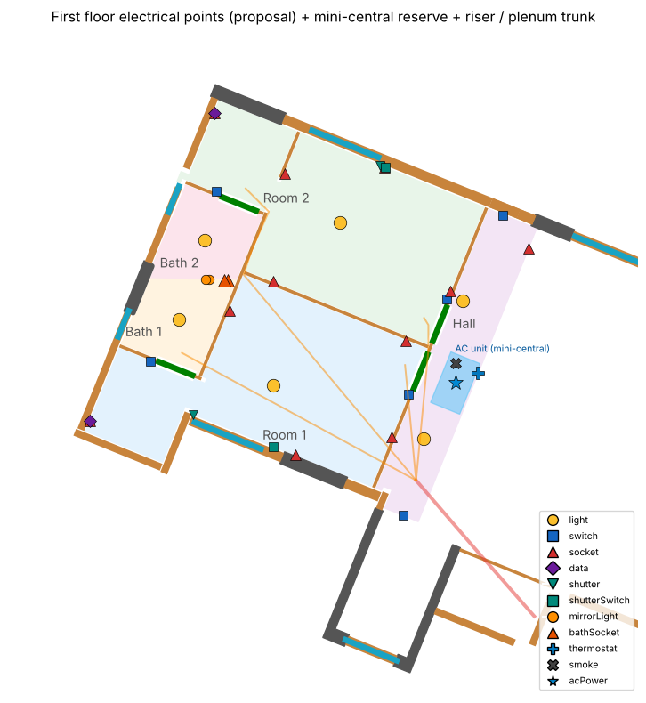

# ח4 – נקודות חשמל בקומה א' (הצעה, 13.11.2026)

**מעמד:** הצעה לאישור אביחי. כמויות וגבהים לפי נוהג מקובל, לא לפי תקן או תוכנית ריהוט.
- נתונים: `data/electrical/points-first.json`, נוצר ע"י `python3 tools/electrical/propose_points_first.py` (קלט: `tools/electrical/points-first-inputs.json`).
- במודל: שכבות ← חשמל ← "נקודות חשמל קומה א'".

**ההחלטה (אביחי, 13.11.2026):** אביחי 13.11.2026: חלופה א' – כל מעגל מהלוח הראשי, כולל שקעים ותאורה בכל חדר.

## 1. החדרים
המקור הוא תוויות האדריכל ("חדר", "קומה א' H=2.80", "חלל כלוא") ונקודות האינסטלציה.

| חדר | שטח (מ"ר) | דלתות | חלונות | מקור |
|---|---|---|---|---|
| חדר 1 | 20.6 | F06, F08 | F04 | sources/plumbing/אינסטלציה חתכים הכל.dxf בלוק alef, שכבה G-ANNO-TEXT (הוצב ב-ITM בהזזה של  |
| חדר 2 | 20.5 | F05, F07 | F03 | sources/plumbing/אינסטלציה חתכים הכל.dxf בלוק alef, שכבה G-ANNO-TEXT (הוצב ב-ITM בהזזה של  |
| מבואה / ראש המדרגות | 8.9 | F07, F08 | — | sources/plumbing/אינסטלציה חתכים הכל.dxf בלוק alef, שכבה G-ANNO-TEXT (הוצב ב-ITM בהזזה של  |
| חדר רחצה 2 | 3.9 | F05 | F01 | קבועות האינסטלציה (data/plumbing/proposal.json) – האזור חולק בין שתי קבוצות הקבועות (מחיצה |
| חדר רחצה 1 | 3.9 | F06 | F02 | קבועות האינסטלציה (data/plumbing/proposal.json) – האזור חולק בין שתי קבוצות הקבועות (מחיצה |

שני חדרי הרחצה נמצאים באזור אחד, כי המחיצה ביניהם לא סגורה בנתונים. חילקתי אותו לפי שתי קבוצות הקבועות.

## 2. כמויות לפי חדר

| חדר | נקודות |
|---|---|
| חדר 1 | 1 נקודת תאורה · 2 מפסק תאורה · 5 שקע · 1 נקודת תקשורת · 1 נקודת מנוע תריס · 1 מפסק תריס |
| חדר 2 | 1 נקודת תאורה · 2 מפסק תאורה · 5 שקע · 1 נקודת תקשורת · 1 נקודת מנוע תריס · 1 מפסק תריס |
| חדר רחצה 1 | 1 תאורה בתקרה · 1 תאורה מעל המראה · 1 שקע מוגן מים (IP44) ליד הכיור |
| חדר רחצה 2 | 1 תאורה בתקרה · 1 תאורה מעל המראה · 1 שקע מוגן מים (IP44) ליד הכיור |
| מבואה / ראש המדרגות | 2 תאורה · 2 מחליף · 1 שקע · 1 תרמוסטט מיני-מרכזי · 1 גלאי עשן · 1 נקודת כוח |

**סה"כ:** 36 נקודות, 7 מעגלי חשמל ו-**13 צינורות בעלייה** מעל הלוח הראשי. ההערכה הקודמת הייתה 16–20.

## 3. גבהים (זמני – E6)

מרכז האביזר מעל רצפה גמורה ‎+3.85:
- שקע 0.3
- מפסק 1.05
- שקע רחצה 1.1
- תאורת מראה 2.0
- תרמוסטט 1.5
- תקשורת 0.3
- מפסק תריס 1.05

נקודות התקרה נמצאות בהנמכה, ב-286.80.

## 4. מעגלים

| מעגל | מה | מא"ז | צינור |
|---|---|---|---|
| F-L1 | תאורה – חדר 1 + רחצה 1 + מבואה | 10A | ø20 |
| F-L2 | תאורה – חדר 2 + רחצה 2 | 10A | ø20 |
| F-S1 | שקעים – חדר 1 | 16A | ø20 |
| F-S2 | שקעים – חדר 2 | 16A | ø20 |
| F-S3 | שקעים – חדרי רחצה + מבואה (פחת 30mA) | 16A | ø20 |
| F-SH | תריסים חשמליים – חדרים 1, 2 | 10A | ø20 |
| F-AC | מיני-מרכזי – יחידה פנימית (ההזנה לעבה בנפרד) | לפי היחידה | ø25 |
| F-ACc | פיקוד מיני-מרכזי – תרמוסטט | — | ø16 |
| F-D1 | תקשורת – חדר 1 | — | ø25 |
| F-D2 | תקשורת – חדר 2 | — | ø25 |
| F-SD | גלאי עשן / אזעקה – מבואה | — | ø16 |
| F-SP | שמור (2 צינורות) | — | 2×ø25 |

## 5. כל הנקודות

| מזהה | חדר | נקודה | E, N (‎179500 / 576200+) | גובה מעל הרצפה (מ') | מעגל |
|---|---|---|---|---|---|
| room1-light-1 | חדר 1 | נקודת תאורה | 94.31, 40.85 | תקרה +6.30 | F-L1 |
| room1-switch-1 | חדר 1 | מפסק תאורה | 97.52, 40.65 | 1.05 | F-L1 |
| room1-switch-2 | חדר 1 | מפסק תאורה – חדר רחצה 1 | 91.38, 41.44 | 1.05 | F-L1 |
| room1-socket-1 | חדר 1 | שקע | 89.94, 40.01 | 0.30 | F-S1 |
| room1-socket-2 | חדר 1 | שקע | 97.45, 41.93 | 0.30 | F-S1 |
| room1-socket-3 | חדר 1 | שקע | 93.27, 42.65 | 0.30 | F-S1 |
| room1-socket-4 | חדר 1 | שקע | 94.84, 39.21 | 0.30 | F-S1 |
| room1-socket-5 | חדר 1 | שקע | 97.11, 39.64 | 0.30 | F-S1 |
| room1-data-1 | חדר 1 | נקודת תקשורת | 89.94, 40.01 | 0.42 | F-D1 |
| room1-shutter-1 | חדר 1 | נקודת מנוע תריס – F04 | 92.40, 40.17 | תקרה +6.60 | F-SH |
| room1-shutterSwitch-1 | חדר 1 | מפסק תריס – F04 | 94.30, 39.41 | 1.05 | F-SH |
| room2-light-1 | חדר 2 | נקודת תאורה | 95.90, 44.75 | תקרה +6.30 | F-L2 |
| room2-switch-1 | חדר 2 | מפסק תאורה | 98.44, 42.92 | 1.05 | F-L2 |
| room2-switch-2 | חדר 2 | מפסק תאורה – חדר רחצה 2 | 92.95, 45.47 | 1.05 | F-L2 |
| room2-socket-1 | חדר 2 | שקע | 92.90, 47.36 | 0.30 | F-S2 |
| room2-socket-2 | חדר 2 | שקע | 98.52, 43.11 | 0.30 | F-S2 |
| room2-socket-3 | חדר 2 | שקע | 94.30, 43.34 | 0.30 | F-S2 |
| room2-socket-4 | חדר 2 | שקע | 96.96, 46.05 | 0.30 | F-S2 |
| room2-socket-5 | חדר 2 | שקע | 94.58, 45.91 | 0.30 | F-S2 |
| room2-data-1 | חדר 2 | נקודת תקשורת | 92.90, 47.36 | 0.42 | F-D2 |
| room2-shutter-1 | חדר 2 | נקודת מנוע תריס – F03 | 96.84, 46.10 | תקרה +6.60 | F-SH |
| room2-shutterSwitch-1 | חדר 2 | מפסק תריס – F03 | 96.98, 46.05 | 1.05 | F-SH |
| bath1-light-1 | חדר רחצה 1 | תאורה בתקרה | 92.06, 42.44 | תקרה +6.30 | F-L1 |
| bath1-mirrorLight-1 | חדר רחצה 1 | תאורה מעל המראה | 92.77, 43.38 | 2.00 | F-L1 |
| bath1-bathSocket-1 | חדר רחצה 1 | שקע מוגן מים (IP44) ליד הכיור | 93.22, 43.37 | 1.10 | F-S3 |
| bath2-light-1 | חדר רחצה 2 | תאורה בתקרה | 92.67, 44.32 | תקרה +6.30 | F-L2 |
| bath2-mirrorLight-1 | חדר רחצה 2 | תאורה מעל המראה | 92.70, 43.38 | 2.00 | F-L2 |
| bath2-bathSocket-1 | חדר רחצה 2 | שקע מוגן מים (IP44) ליד הכיור | 93.15, 43.37 | 1.10 | F-S3 |
| hall-light-1 | מבואה / ראש המדרגות | תאורה – מבואה | 97.89, 39.59 | תקרה +6.30 | F-L1 |
| hall-light-2 | מבואה / ראש המדרגות | תאורה – מבואה | 98.82, 42.87 | תקרה +6.30 | F-L1 |
| hall-switch-1 | מבואה / ראש המדרגות | מחליף – ראש המדרגות | 97.39, 37.77 | 1.05 | F-L1 |
| hall-switch-2 | מבואה / ראש המדרגות | מחליף – קצה המבואה | 99.77, 44.92 | 1.05 | F-L1 |
| hall-socket-1 | מבואה / ראש המדרגות | שקע | 100.38, 44.12 | 0.30 | F-S3 |
| hall-thermostat-1 | מבואה / ראש המדרגות | תרמוסטט מיני-מרכזי | 99.18, 41.15 | 1.50 | F-ACc |
| hall-smoke-1 | מבואה / ראש המדרגות | גלאי עשן | 98.64, 41.38 | תקרה +6.30 | F-SD |
| hall-acPower-1 | מבואה / ראש המדרגות | נקודת כוח – מיני-מרכזי (בחלל הטכני) | 98.64, 40.92 | תקרה +6.63 | F-AC |

## 6. בדיקות
28 בדיקות, 0 נכשלו (כל אביזר קיר על פני הקיר; שקע הרחצה לפחות 0.60 מ' מהמקלחת).

## 7. פתוח

| # | נושא |
|---|---|
| E6 | טבלת הגבהים |
| E7 | מיקום המיטה והטלוויזיה בכל חדר. השקעים מפוזרים לאורך הקירות הפנויים, ויוזזו לפי הריהוט |
| E24 | צד הידית בכל דלת, לצורך מיקום המפסק |
| E25 | מרפסות קומה א' (צפון ודרום-מערב): תאורה ושקע מוגן מים – לא נכללו, לאשר |
| E26 | תאורת המדרגות – בקומת הקרקע, עם המחליף שבראש המדרגות |
