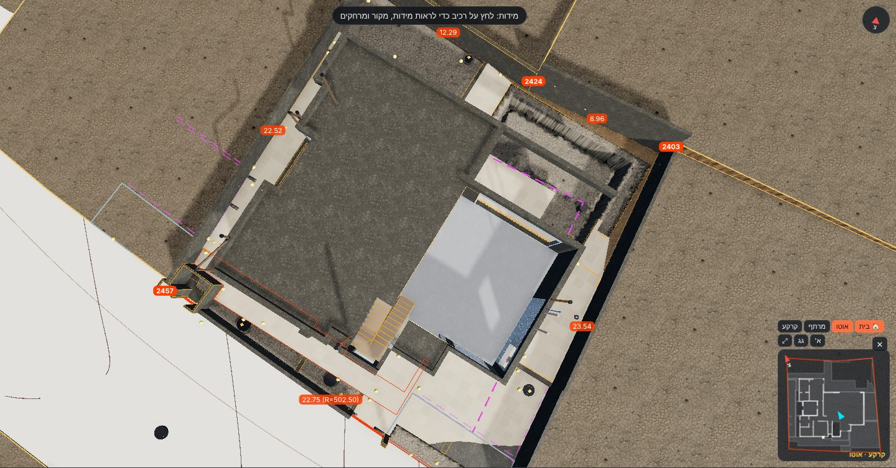
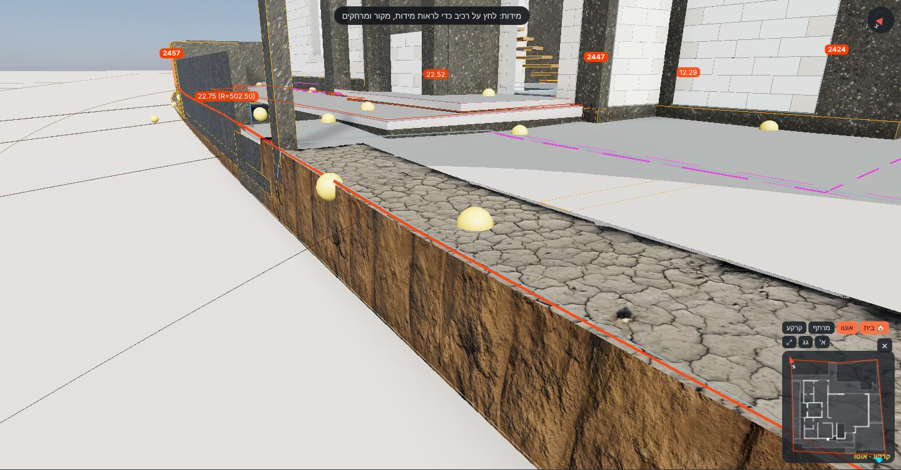

# אימות – ריצוף חוץ ושכבותיו (13.11.2026)

**מה נבנה:** ריצוף על כל רצפות הבטון החיצוניות של קומת הקרקע (K-21). יש 6 אזורים, ‏172.95 מ"ר:
- מרפסת GS2
- חניה GS3
- חצר דרומית GS4
- מרווח מערבי GS5
- חצר מזרחית GS6
- כניסה GS8

**השכבות, מלמטה למעלה:**
1. רצפת בטון (קיים)
2. **בטון שיפועים**. עוביו משתנה: התחתית אופקית על היציקה, והראש בשיפוע הריצוף.
3. **איטום צמנטי גמיש**, 2 שכבות, ‏3 מ"מ
4. **דבק C2TE S1** בהדבקה כפולה, ‏7 מ"מ
5. **אריח חוץ** נגד החלקה, ‏10 מ"מ. נבחר בסדנת הריצוף.

כל אזורי החוץ מופיעים בסדנה בקבוצה "ריצוף חוץ (פיתוח)", עם אותם כלים כמו בפנים: מידה, גימור, דוגמה, פוגה, פריסה מושלמת וכמויות. ברירת המחדל: ‏60×60, ‏R11, פוגה 3 מ"מ.

**פני הריצוף נלקחו מהיתר הבנייה.** ב-31 גבהי הפיתוח שבגרמושקה (`data/site/development-heights.json`, תוכנית "קרקע פיתוח"), 28 נקודות נופלות על אזורי הריצוף. השיפועים 1.5% ו-2% כתובים בתוכנית "קומה קרקע – פיתוח היקפי".

איך נבנה המשטח:
- מחושב מישור מיטבי (ריבועים פחותים).
- הסטיות בנקודות מתוקנות בשקלול מרחק הפוך (IDW, חזקה 2).
- התוצאה: המשטח עובר **בדיוק** בכל נקודת גובה, ובין הנקודות הוא קרוב למישור.

**נקודות שהוצאו:** נקודה שהתווית שלה מחוץ לרצפה וסוטה מהמישור ביותר מ-3 ס"מ. מדובר בגבהי גינה בשולי האזור, ושתיים כאלה הוצאו.

**חריג:** ‏280.00 בשער החניה נכלל, למרות שהתווית רחוקה 0.67 מ' מהרצפה. זה קצה השיפוע של 2% שמופיע בתוכנית.

- **כלי:** `python3 tools/finishes/derive_exterior.py`. הוא כותב את `data/finishes/tiling/exterior.json`.
- **הגדרות:** `data/finishes/floors/exterior-buildup.json`.
- **קוד:** `src/tiling/layout.js` (‏`surfaceZ` ו-`gridPieces`), `src/finishes/index.js` (שכבות על משטח בשיפוע, בתאים של 0.5 מ'), `src/tiling/workshop.js` (האריחים על המשטח).

## אזורים, מפלסים ועוביים

| אזור | רצפה | שטח מ"ר | פני בטון (K-21) | פני ריצוף במודל מינ׳–מקס׳ | שיפוע המישור (אזימוט רשת של הירידה) | בטון שיפועים מינ׳–מקס׳ (ממוצע) ס"מ | בטון שיפועים מ"ק | נקודות / הוצאו | מצב |
|---|---|---|---|---|---|---|---|---|---|
| מרפסת / משטח מרוצף | GS2 | 48.81 | ‎−0.15 (280.35) | 280.46–280.48 | 0.03% (כמעט אופקי) | 9.0–11.0 (10.6) | 5.18 | 6 / 0 | זמני |
| חניה | GS3 | 46.07 | ‎−0.47 (280.03) | 279.96–280.17 | 2.35% לכיוון 164° (דרום – השער) | **‎−8.6**–11.6 (2.1) | 0.98 | 6 / 0 | ⛔ סתירה (#196) |
| חצר דרומית / שביל | GS4 | 26.54 | ‎−0.31 (280.19) | 280.27–280.37 | 1.76% לכיוון 209° | 6.5–15.8 (9.3) | 2.47 | 6 / 2 | זמני |
| מרווח מערבי | GS5 | 24.72 | ‎−0.26 (280.24) | 280.34–280.49 | 2.04% לכיוון 314° | 7.9–23.3 (17.7) | 4.39 | 5 / 0 | זמני (#198) |
| חצר מזרחית | GS6 | 20.21 | ‎−0.31 (280.19) | 280.37–280.47 | 1.41% לכיוון 201° | 16.3–26.1 (21.0) | 4.25 | 2 / 0 | זמני (#198) |
| כניסה מקורה | GS8 | 6.60 | ‎−0.15 (280.35) | 280.48 | 0% (נקודה אחת) | 11.0 | 0.73 | 1 / 0 | זמני |
| **סה"כ** | | **172.95** | | | | | **18.00** | 26 / 2 | |

**השיפוע מול התוכנית:**
- **חניה:** בתוכנית 2% לכיוון השער, במודל 2.35%.
- **חצר דרומית ומרווח מערבי:** בתוכנית 1.5% (חיצים), במודל המישור המיטבי יוצא 1.8% ו-2.0%.
- הסיבה להפרש: משטח אחד בכל אזור לא יכול לייצג חיצים לכמה כיוונים, אל תעלות הניקוז שבגבול המגרש. המשטח במודל עובר בכל הנקודות, אבל הוא לא מחלק את האזור למפנים (#199).

## נקודות גובה: היתר מול המודל

"במודל" = פני האריח בנקודה. "מהמישור" = כמה המישור לבדו היה מפספס (לפני התיקון).

| אזור | ישות | גובה בהיתר | במודל (פני אריח) | סטייה מ"מ | מהמישור בלבד ס"מ |
|---|---|---|---|---|---|
| GS2 | 180F7 | 280.46 | 280.460 | 0 | +1.5 |
| GS2 | 180FA | 280.48 | 280.480 | 0 | ‎−0.5 |
| GS2 | 180FD | 280.48 | 280.480 | 0 | ‎−0.5 |
| GS2 | 18100 | 280.47 | 280.470 | 0 | +0.5 |
| GS2 | 18160 | 280.48 | 280.480 | 0 | ‎−0.4 |
| GS2 | 18414 | 280.48 | 280.480 | 0 | ‎−0.6 |
| GS3 | 18083 | 280.00 | 280.000 | 0 | +1.3 |
| GS3 | 18086 | 280.12 | 280.120 | 0 | +2.4 |
| GS3 | 1808C | 280.06 | 280.060 | 0 | +5.5 |
| GS3 | 18106 | 280.14 | 280.140 | 0 | ‎−1.7 |
| GS3 | 18128 | 280.16 | 280.160 | 0 | ‎−5.1 |
| GS3 | 1815D | 280.12 | 280.120 | 0 | ‎−2.3 |
| GS4 | 18115 | 280.31 | 280.310 | 0 | ‎−0.4 |
| GS4 | 18118 | 280.29 | 280.290 | 0 | ‎−0.3 |
| GS4 | 18122 | 280.28 | 280.280 | 0 | +1.2 |
| GS4 | 18125 | 280.32 | 280.320 | 0 | ‎−1.3 |
| GS4 | 1815A | 280.31 | 280.310 | 0 | +0.9 |
| GS4 | 181D5 | 280.29 | 280.290 | 0 | ‎−0.1 |
| GS4 | 18128 | 280.16 | הוצאה: גובה החניה, מחוץ לרצפה, 13.6 ס"מ מהמישור | — | — |
| GS4 | 1811B | 280.19 | הוצאה: גינון 4, מחוץ לרצפה, 8.7 ס"מ מהמישור | — | — |
| GS5 | 18112 | 280.47 | 280.470 | 0 | ‎−2.4 |
| GS5 | 18447 | 280.34 | 280.340 | 0 | +2.2 |
| GS5 | 1844A | 280.47 | 280.470 | 0 | ‎−4.1 |
| GS5 | 18493 | 280.44 | 280.440 | 0 | +2.7 |
| GS5 | 18496 | 280.47 | 280.470 | 0 | +1.5 |
| GS6 | 18100 | 280.47 | 280.470 | 0 | 0 |
| GS6 | 18103 | 280.38 | 280.380 | 0 | 0 |
| GS8 | 18089 | 280.48 | 280.480 | 0 | 0 |

**בדיקה אוטומטית** (`tests/tiling.mjs`, חלק מ-`npm test`, מחשב וטלפון). הבדיקה מוודאת ש:
- בסדנה יש 6 אזורי חוץ, כמו ב-`exterior.json`.
- בכל נקודת גובה, פני האריח במודל = הגובה בהיתר, בסטייה של עד 1 מ"מ.
- ראש בטון השיפועים + השכבות = פני הריצוף.
- 6 רכיבי אריח יושבים על שכבת `extTile`.
- אין שגיאות בקונסול.

## פתוח

- #195 – סדר השכבות והעוביים בחוץ (איטום, דבק, אריח 10 / 20 מ"מ). זמני, אין פרט במקורות (המשך של #170).
- #196 – ⛔ חניה: פני הריצוף בהיתר נמוכים מפני הבטון ‎−0.47 בצד השער.
- #197 – סוג האריח בחוץ (במקורות כתוב רק "ריצוף נוגד החלקה") והחומר בחניה.
- #198 – בטון שיפועים עבה, עד 23–26 ס"מ, במרווח המערבי ובחצר המזרחית.
- #199 – מה עוד לא נבנה: מפנים לתעלות ניקוז, מדרך הבריכה ותעלות הגלישה, מרפסת קומה א' (‎+3.83) והגג.
