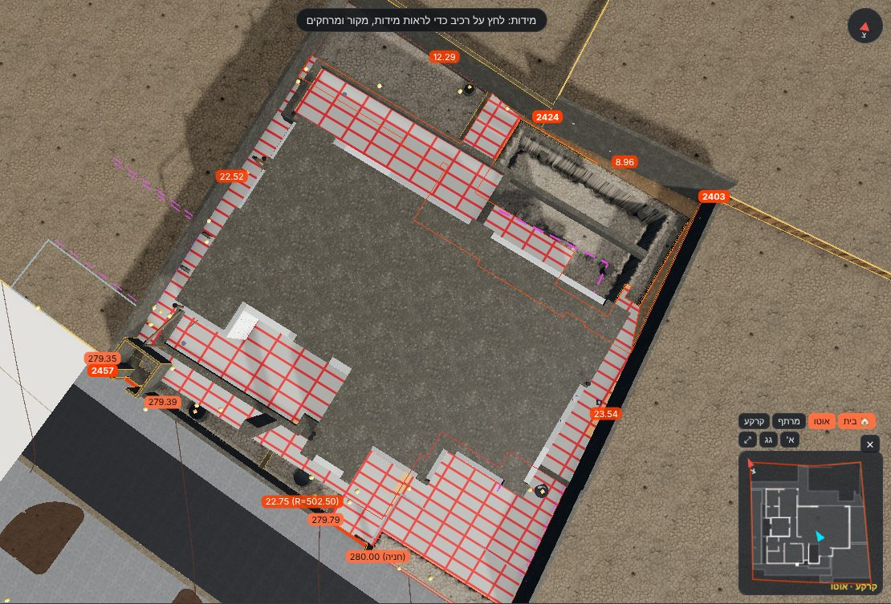

# אימות – ריצוף חוץ ושכבותיו (13.11.2026)

**מה נבנה:** ריצוף על כל רצפות הבטון החיצוניות של קומת הקרקע (K-21). יש 6 אזורים, ‏172.95 מ"ר:
- מרפסת GS2
- חניה GS3
- חצר דרומית GS4
- מרווח מערבי GS5
- חצר מזרחית GS6
- כניסה GS8

**השכבות, מלמטה למעלה:**
1. רצפת בטון (קיים)
2. **בטון שיפועים**. עוביו משתנה: התחתית אופקית על היציקה, והראש בשיפוע הריצוף.
3. **איטום צמנטי גמיש**, 2 שכבות, ‏3 מ"מ
4. **דבק C2TE S1** בהדבקה כפולה, ‏7 מ"מ
5. **אריח חוץ** נגד החלקה, ‏10 מ"מ. נבחר בסדנת הריצוף.

כל אזורי החוץ מופיעים בסדנה בקבוצה "ריצוף חוץ (פיתוח)", עם אותם כלים כמו בפנים: מידה, גימור, דוגמה, פוגה, פריסה מושלמת וכמויות. ברירת המחדל: ‏60×60, ‏R11, פוגה 3 מ"מ.

**פני הריצוף נלקחו מהיתר הבנייה.** ב-31 גבהי הפיתוח שבגרמושקה (`data/site/development-heights.json`, תוכנית "קרקע פיתוח"), 28 נקודות נופלות על אזורי הריצוף. השיפועים 1.5% ו-2% כתובים בתוכנית "קומה קרקע – פיתוח היקפי".

איך נבנה המשטח:
- מחושב מישור מיטבי (ריבועים פחותים).
- הסטיות בנקודות מתוקנות בשקלול מרחק הפוך (IDW, חזקה 2).
- התוצאה: המשטח עובר **בדיוק** בכל נקודת גובה, ובין הנקודות הוא קרוב למישור.

**נקודות שהוצאו:** נקודה שהתווית שלה מחוץ לרצפה וסוטה מהמישור ביותר מ-3 ס"מ. מדובר בגבהי גינה בשולי האזור, ושתיים כאלה הוצאו.

**חריג:** ‏280.00 בשער החניה נכלל, למרות שהתווית רחוקה 0.67 מ' מהרצפה. זה קצה השיפוע של 2% שמופיע בתוכנית.

- **כלי:** `python3 tools/finishes/derive_exterior.py`. הוא כותב את `data/finishes/tiling/exterior.json`.
- **הגדרות:** `data/finishes/floors/exterior-buildup.json`.
- **קוד:** `src/tiling/layout.js` (‏`surfaceZ` ו-`gridPieces`), `src/finishes/index.js` (שכבות על משטח בשיפוע, בתאים של 0.5 מ'), `src/tiling/workshop.js` (האריחים על המשטח).

## החניה – לפי K-21, מסומנת לשינוי (OC-16, החלטת אביחי 13.11.2026)

בחתך החומה המזרחית של האדריכל רצפת הבטון בחניה יצוקה בשיפוע 2%, ‎−0.50 ← ‎−0.64. ב-K-21 היא ‎−0.47 אופקית. עד תשובת הקונסטרוקטור המודל לפי K-21:
- פני הריצוף לא יורדים מתחת לפני הבטון + 2 ס"מ שכבות + 3 ס"מ בטון שיפועים מינימלי = **280.08**.
- שתי נקודות גובה מההיתר (280.00 בשער, 280.06) הוגבהו ל-280.08.
- התוצאה: מדרגה של כ-8 ס"מ בשער מעל הרחוב (280.00), ושיפוע של כ-0.9% במקום 2%.
- במודל: קו אדום סביב החניה ותווית "OC-16 – לשינוי", ובכרטיס ובסדנה – 🔴.

## אזורים, מפלסים ועוביים

| אזור | רצפה | שטח מ"ר | פני בטון (K-21) | פני ריצוף במודל מינ׳–מקס׳ | שיפוע המישור (אזימוט רשת של הירידה) | בטון שיפועים מינ׳–מקס׳ (ממוצע) ס"מ | בטון שיפועים מ"ק | נקודות / הוצאו | מצב |
|---|---|---|---|---|---|---|---|---|---|
| מרפסת / משטח מרוצף + משטח הבריכה | GS2 | 56.46 (48.81 + 7.64) | ‎−0.15 (280.35) | 280.46–280.48 | 0.03% (כמעט אופקי) | 9.0–11.0 (10.6) | 5.18 | 6 / 0 | זמני |
| חניה | GS3 | 46.07 | ‎−0.47 (280.03) | 280.08–280.16 | 0.88% לכיוון השער (במקום 2%) | 3.0–11.1 (5.4) | 2.47 | 6 / 0 | 🔴 לשינוי – OC-16 (#201) |
| חצר דרומית / שביל | GS4 | 26.54 | ‎−0.31 (280.19) | 280.27–280.37 | 1.76% לכיוון 209° | 6.5–15.8 (9.3) | 2.47 | 6 / 2 | זמני |
| מרווח מערבי | GS5 | 24.72 | ‎−0.26 (280.24) | 280.34–280.49 | 2.04% לכיוון 314° | 7.9–23.3 (17.7) | 4.39 | 5 / 0 | זמני (#203) |
| חצר מזרחית | GS6 | 20.21 | ‎−0.31 (280.19) | 280.37–280.47 | 1.41% לכיוון 201° | 16.3–26.1 (21.0) | 4.25 | 2 / 0 | זמני (#203) |
| כניסה מקורה | GS8 | 6.60 | ‎−0.15 (280.35) | 280.48 | 0% (נקודה אחת) | 11.0 | 0.73 | 1 / 0 | זמני |
| **סה"כ** | | **172.95** | | | | | **18.00** | 26 / 2 | |

**השיפוע מול התוכנית:**
- **חניה:** בתוכנית 2% לכיוון השער, במודל 2.35%.
- **חצר דרומית ומרווח מערבי:** בתוכנית 1.5% (חיצים), במודל המישור המיטבי יוצא 1.8% ו-2.0%.
- הסיבה להפרש: משטח אחד בכל אזור לא יכול לייצג חיצים לכמה כיוונים, אל תעלות הניקוז שבגבול המגרש. המשטח במודל עובר בכל הנקודות, אבל הוא לא מחלק את האזור למפנים (#204).

## נקודות גובה: היתר מול המודל

"במודל" = פני האריח בנקודה. "מהמישור" = כמה המישור לבדו היה מפספס (לפני התיקון).

| אזור | ישות | גובה בהיתר | במודל (פני אריח) | סטייה מ"מ | מהמישור בלבד ס"מ |
|---|---|---|---|---|---|
| GS2 | 180F7 | 280.46 | 280.460 | 0 | +1.5 |
| GS2 | 180FA | 280.48 | 280.480 | 0 | ‎−0.5 |
| GS2 | 180FD | 280.48 | 280.480 | 0 | ‎−0.5 |
| GS2 | 18100 | 280.47 | 280.470 | 0 | +0.5 |
| GS2 | 18160 | 280.48 | 280.480 | 0 | ‎−0.4 |
| GS2 | 18414 | 280.48 | 280.480 | 0 | ‎−0.6 |
| GS3 | 18083 | 280.00 | 280.080 – הוגבה (מצב K-21, OC-16) | +80 | — |
| GS3 | 18086 | 280.12 | 280.120 | 0 | +2.4 |
| GS3 | 1808C | 280.06 | 280.080 – הוגבה (מצב K-21, OC-16) | +20 | — |
| GS3 | 18106 | 280.14 | 280.140 | 0 | ‎−1.7 |
| GS3 | 18128 | 280.16 | 280.160 | 0 | ‎−5.1 |
| GS3 | 1815D | 280.12 | 280.120 | 0 | ‎−2.3 |
| GS4 | 18115 | 280.31 | 280.310 | 0 | ‎−0.4 |
| GS4 | 18118 | 280.29 | 280.290 | 0 | ‎−0.3 |
| GS4 | 18122 | 280.28 | 280.280 | 0 | +1.2 |
| GS4 | 18125 | 280.32 | 280.320 | 0 | ‎−1.3 |
| GS4 | 1815A | 280.31 | 280.310 | 0 | +0.9 |
| GS4 | 181D5 | 280.29 | 280.290 | 0 | ‎−0.1 |
| GS4 | 18128 | 280.16 | הוצאה: גובה החניה, מחוץ לרצפה, 13.6 ס"מ מהמישור | — | — |
| GS4 | 1811B | 280.19 | הוצאה: גינון 4, מחוץ לרצפה, 8.7 ס"מ מהמישור | — | — |
| GS5 | 18112 | 280.47 | 280.470 | 0 | ‎−2.4 |
| GS5 | 18447 | 280.34 | 280.340 | 0 | +2.2 |
| GS5 | 1844A | 280.47 | 280.470 | 0 | ‎−4.1 |
| GS5 | 18493 | 280.44 | 280.440 | 0 | +2.7 |
| GS5 | 18496 | 280.47 | 280.470 | 0 | +1.5 |
| GS6 | 18100 | 280.47 | 280.470 | 0 | 0 |
| GS6 | 18103 | 280.38 | 280.380 | 0 | 0 |
| GS8 | 18089 | 280.48 | 280.480 | 0 | 0 |

**בדיקה אוטומטית** (`tests/tiling.mjs`, חלק מ-`npm test`, מחשב וטלפון). הבדיקה מוודאת ש:
- בסדנה יש 6 אזורי חוץ, כמו ב-`exterior.json`.
- בכל נקודת גובה, פני האריח במודל = הגובה בהיתר, בסטייה של עד 1 מ"מ.
- ראש בטון השיפועים + השכבות = פני הריצוף.
- באזור לפי K-21 (החניה) בטון השיפועים לא דק מהמינימום, ויש סימון לשינוי.
- 6 רכיבי אריח יושבים על שכבת `extTile`.
- אין שגיאות בקונסול.

## בטון שנוצק עם הרצפות מחוץ לפוליגון שלהן – הריצוף מכסה אותו (13.11.2026)

**הבעיה (צילום של אביחי, B-39):** אזור ריצוף נבנה מפוליגון הרצפה בלבד, ואילו הקורות שראשן בגובה הרצפה (K-21, למשל B-37…B-40 ‎-0.15) שורטטו בין הרצפות, מחוץ לפוליגון. גם רצפת הבית GS1 יוצאת מקווי החזית: לאורך החצרות האנגליות במערב, מעל ראש קיר המרתף BW1 (‎-0.15). אף אזור לא כיסה את החלקים האלה, ולכן הם נראו כבטון חשוף בין הריצופים.

**התיקון (`tools/finishes/derive_exterior.py` → `concrete_tops`):**
1. **חוץ:** לוקחים כל קורת קרקע, ראש קיר מרתף וחלק של GS1 / GS7, ומורידים מהם את הרצפות, הקירות, החומות, החצרות האנגליות, קירות הבלוקים והחדרים. כל חתיכה שנשארת מצטרפת לאזור הריצוף שהיא גובלת בו הכי הרבה. התנאי: השכבות (2 ס"מ) והמילוי המינימלי (3 ס"מ) נכנסים מעליה. **כשהמילוי יוצא שלילי עד 5 ס"מ**, פני הריצוף מוגבהים מקומית מעל החתיכה (`surface.raise`). כשהוא שלילי יותר, החתיכה לא מרוצפת ונרשמת ב-`notFit`.
2. **פנים ומרפסות:** קורות שראשן בגובה הרצפה (עד 3 ס"מ) נכנסות לרצפה (`derive_finishes.py`, `tilingZones.flushBeam_m`). בפנים זה שינה רק את המרתף (‎+0.042 מ"ר).

| אזור | שטח לפני מ"ר | אחרי | תוספת | מה נוסף | הגבהה מקסימלית ס"מ |
|---|---|---|---|---|---|
| מרפסת / משטח מרוצף (GS2) | 56.456 | 57.113 | +0.657 | B-38, B-39, B-55, GS1 | 0.0 |
| חניה (GS3) | 46.073 | 46.567 | +0.494 | B-59, B-60 | 0.0 |
| חצר דרומית / שביל (GS4) | 26.539 | 26.794 | +0.255 | B-56 | 0.0 |
| מרווח מערבי (GS5) | 24.721 | 29.952 | +5.231 | B-39, B-40, B-43, GS1 | 3.3 |
| חצר מזרחית (GS6) | 20.208 | 20.208 | +0.000 | — | 0.0 |
| כניסה מקורה (GS8) | 6.597 | 6.597 | +0.000 | — | 0.0 |

- **בדיקת כיסוי** (כל הבטון ב-‎-0.50 ומעלה בקומת הקרקע, פחות האזורים, הקירות והחצרות האנגליות): לפני התיקון נשארו 5.26 מ"ר לא מרוצפים במערב. אחרי התיקון נשארו רק החתיכות שבטבלה למטה.
- **סתירה (#208):** נקודת הגובה בהיתר 18447 (280.34) יושבת על B-39 שראשו 280.35. הריצוף לא נכנס בגובה הזה, ולכן הוגבה מעל הקורה ל-280.37 (‎+3 ס"מ).
- **לא מרוצף (גבוה מדי לריצוף לפי ההיתר):** GS1 ליד GS3 (0.925 מ"ר, ראש ‎-0.15, מילוי -25.1 ס"מ); GS1 ליד GS3 (0.105 מ"ר, ראש ‎-0.15, מילוי -23.8 ס"מ); GS1 ליד GS3 (0.115 מ"ר, ראש ‎-0.15, מילוי -25.7 ס"מ); B-45 ליד GS4 (0.119 מ"ר, ראש ‎+0.20, מילוי -39.9 ס"מ); GS1 ליד GS4 (0.177 מ"ר, ראש ‎-0.15, מילוי -5.7 ס"מ); BW1-cap3 ליד GS4 (0.163 מ"ר, ראש ‎-0.15, מילוי -5.7 ס"מ).

## פתוח

- #200 – סדר השכבות והעוביים בחוץ (איטום, דבק, אריח 10 / 20 מ"מ). זמני, אין פרט במקורות (המשך של #170).
- #201 / OC-16 – חניה: האדריכל (יציקה בשיפוע) מול K-21 (אופקי). במודל לפי K-21, מסומן לשינוי.
- #202 – סוג האריח בחוץ (במקורות כתוב רק "ריצוף נוגד החלקה") והחומר בחניה.
- #203 – בטון שיפועים עבה, עד 23–26 ס"מ, במרווח המערבי ובחצר המזרחית.
- #204 – מה עוד לא נבנה: מפנים לתעלות ניקוז, מדרך הבריכה ותעלות הגלישה, מרפסת קומה א' (‎+3.83) והגג.

## רשת פוגות משותפת – כל ריצוף החוץ והמרפסות (13.11.2026)

**הבקשה של אביחי:** להמשיך את הריצוף שהתחיל במרפסת GS2, באותו כיוון ובאותו צבע, על כל הגינה ההיקפית ועל המרפסות בקומה א'. קווי הפוגה ממשיכים בין המפלסים והחלקים, והחיתוכים לפי המקובל.

**מה נעשה:**
- **בחירת האריח:** כמו ב-GS2. אריח 60×120 "חוץ – אפור בטון (R11)", לרוחב (90°), ישר, פוגה 3 מ"מ, רובה אפורה.
- **רשת אחת לכל האזורים:** 8 אזורים, ‏236.6 מ"ר, יושבים על רשת אחת (`catalog.json → gridGroups.ext`).
  - המסגרת היא של GS2: כיוון הקירות 68° ברשת ITM, ונקודת התחלה אחת לכולם.
  - בדיקה: לכל 8 האזורים אותה נקודת התחלה בתוכנית, ולכן קווי הפוגה רציפים מאזור לאזור וגם בין קומת הקרקע למרפסות.
- **פריסה מושלמת לכל הרשת:** ההזזה נבחרה כך שבכל 8 האזורים יחד יהיו הכי מעט חיתוכים צרים מ-5 ס"מ, ואחר כך הכי מעט חיתוכים מתחת לשליש אריח.
  - ההזזה שנבחרה: -50.1 / -2.5 ס"מ (הציון ירד מ-2025 ל-527).
  - חיתוכים צרים מ-5 ס"מ: 16 → **2**.
  - חיתוכים מתחת לשליש אריח: 68 → 94.
- **כמויות:** 524 אריחים, 262 קרטונים (2 אריחים בקרטון, זמני), כולל 5% רזרבה.

| אזור | מ"ר | שלמים | חתוכים | צרים מ-5 ס"מ | מתחת לשליש | חיתוך מינימלי ס"מ | להזמנה (אריחים / קרטונים) |
|---|---|---|---|---|---|---|---|
| מרפסת צפונית – קומה א' | 31.29 | 27 | 27 | 0 | 7 | 9.7 | 58 / 29 |
| מרפסת דרום-מערבית – קומה א' | 22.20 | 17 | 36 | 0 | 25 | 9.1 | 58 / 29 |
| מרפסת / משטח מרוצף | 58.65 | 41 | 88 | 1 | 8 | 2.2 | 136 / 68 |
| חניה | 46.07 | 46 | 39 | 0 | 17 | 5 | 90 / 45 |
| חצר דרומית / שביל | 26.54 | 21 | 36 | 0 | 13 | 17.8 | 60 / 30 |
| מרווח מערבי | 24.72 | 0 | 48 | 0 | 0 | 40.7 | 51 / 26 |
| חצר מזרחית | 20.21 | 20 | 28 | 0 | 18 | 12.4 | 51 / 26 |
| כניסה מקורה | 6.89 | 4 | 15 | 1 | 6 | 0.1 | 20 / 10 |

**החלק ההיקפי לבריכה = אותו משטח כמו המרפסת** (אביחי 13.11.2026).
- **מה היה:** ב-K-21 אין רצפה בין תעלת הגלישה ותעלת הכיסוי לבין החומות במזרח ובצפון. לכן GS2 נגמרה בקו אלכסוני (בקירוב, לאורך B-37).
- **מה נעשה:** ‏7.64 מ"ר צורפו לאזור GS2, ועכשיו זה פוליגון אחד ומשטח אחד (`exterior-buildup.json → zones.GS2.extendPoolDeck`). האריחים לא נחתכים בקו האלכסוני.
- **פני הבטון שם:** ‏280.33 ("משטח בטון" בחתכי הבריכה, `pool.json → deckSlabTop`), ובטון השיפועים מתחיל ממנו.
- **מה לא מרוצף:** הבריכה, תעלת הגלישה, תעלת הכיסוי וחדר המכונות.

**אזור הדלתות שייך לחוץ** (אביחי 13.11.2026). הרצועה בעובי הקיר מתחת לפתח החוצה מצטרפת לאזור החוץ שלו (`tools/finishes/door_strips.py`), והאריחים נמשכים דרך הסף:
- G01, דלת הכניסה → הכניסה המקורה
- G16 ו-G18, ויטרינות → המרפסת GS2
- F03 ו-F04, ויטרינות → המרפסות של קומה א'

**נשאר:** 2 חיתוכים צרים מ-5 ס"מ:
- ב-GS2: חיתוך של 2.2 ס"מ
- בכניסה המקורה: חיתוך פינה

במקום כזה מקובל להזיז מקומית או לשנות את רוחב הפוגה בשורה. אפשר גם לנתק אזור מהרשת המשותפת ולפרוס אותו לבד.

