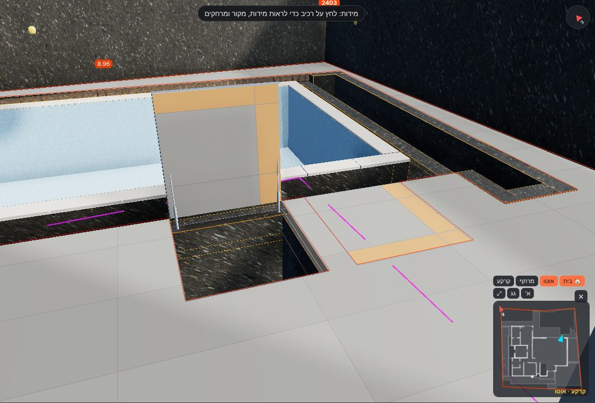

# אימות – מכסי ריצוף מעל חדר המכונות של הבריכה (13.11.2026)

**הבקשה של אביחי:** מכסים מרוצפים שעולים כלפי מעלה. ציר שנפתח ל-95°, בוכנה הידראולית, מסגרת מתכת. המכסים מחופים בריצוף באותה פריסה כמו הריצוף מסביב.

**סוג המוצר:** מכסה שקוע למילוי ריצוף (recessed tile-insert access cover). מסגרת ומגש מנירוסטה 316, כי זו סביבת בריכה. אטם EPDM, 2 בוכנות (גז / הידראוליות), ציר בצד אחד.
- דוגמאות מהרשת: [Inza TIRA](https://www.archiexpo.com/prod/inza-inox-sl/product-4658221-2555780.html) – מכסה למילוי עם בוכנות גז, לחדרים טכניים של בריכות. [ACO UniFace GS/SS](https://www.aco.co.uk/products/uniface-access-covers) – עומק מסגרת 83 מ"מ.
- ספק ודגם עוד לא נבחרו, ולכן כל מידות המוצר זמניות (`data/finishes/exterior/hatches-config.json`, ‏#208).

## הפתחים – מתוכנית האדריכל

- **המקור:** שני המלבנים "פתח מכונות" ו"פתח בור איזון" בתוכנית "קומה קרקע – פיתוח היקפי" (וקטור).
- **קנה המידה:** 1:100.0 (28.339 נק'/מ'). אומת מול הבריכה ב-K-21: מישורי הפנים 8.00 × 3.29 מ' (אורך 28.35, רוחב 28.328 נק'/מ').
  - מידות החניה בתוכנית (600 / 500) לא תואמות את קווי המידה שלהן ב-1:100, ולכן לא השתמשתי בהן.
- **המיקום:** נמדד ממישורי הפנים של הבריכה (`data/structure/pool.json`).
  - הקצה הצפוני של שני הפתחים נמצא 0.648 מ' מפני הבריכה. פני הקיר הצפוני הפנימי של חדר המכונות נמצאים 0.65 מ' ממנה (קיר 0.20 + תעלת גלישה 0.25 + שפה 0.20). כלומר שני מקורות שונים תואמים בהפרש של 2 מ"מ.

| # | מכסה | פתח נקי ס"מ | ממישור הפנים המזרחי של הבריכה (מ', מערבה) | ממישור הפנים הדרומי (מ', דרומה) | ציר |
|---|---|---|---|---|---|
| H1 | מכסה חדר מכונות | 99.9 × 106.7 | 1.427–2.426 | 0.648–1.715 | ציר בצד הבריכה |
| H2 | מכסה בור איזון | 99.9 × 106.7 | 0.216–1.215 | 0.648–1.715 | ציר בצד הבריכה |

## מה במודל (`src/tiling/hatches.js`)

- **תקרת חדר המכונות:** 280.13–280.33 (20 ס"מ), עם שני הפתחים.
  - הראש לפי ראש הקירות (pool.json). התחתית לפי "גובה פנים 180" בחתך א, מעל הרצפה 278.33.
  - זמני: עד היום לא הייתה בכלל תקרה, וחדר המכונות היה פתוח מלמעלה.
- **הריצוף מסביב:** תקרת חדר המכונות (3.75 מ"ר, בלי הפתחים) מרוצפת כחלק ממשטח הבריכה GS2, על בטון 280.33.
- **המסגרת:** נירוסטה בפתח. פס של 6 מ"מ נראה בפני הריצוף, עומק 83 מ"מ.
- **המכסה (המגש):** דפנות ותחתית נירוסטה ומצע טיט / דבק. מעליו **אריחים באותה רשת פוגות של הריצוף מסביב** – אזורים ext:H1 / ext:H2 בסדנת הריצוף, ברשת המשותפת "ריצוף חוץ ומרפסות", ולכן קווי הפוגה ממשיכים על המכסה.
- **הפתיחה:** לחיצה על המכסה פותחת אותו ל-**95°** סביב הציר בצד הבריכה, ולחיצה נוספת סוגרת. 2 בוכנות, אחת בכל צד (צילינדר + מוט), עוקבות אחרי התנועה.
- **שכבה:** "ריצוף חוץ: מכסי חדר המכונות". נדלקת במצב ריצוף.

**בדיקה אוטומטית** (`tests/tiling.mjs`): נבנו 2 מכסים. בפתיחה זווית הסיבוב היא בדיוק 95° והאריחים מחוברים למכסה. בסגירה – 0°.

## פתוח – #208

- **הספק והדגם:** קובעים עומק מגש, פס מסגרת, עומס (A15 / B125) וסוג בוכנה (גז / הידראולית).
- **צד הציר:** הנחתי צד הבריכה. כשהמכסה פתוח הוא עומד כמחיצה בין הפתח לבריכה.
- **התקרה:** עובי 20 ס"מ (נגזר מ"גובה פנים 180"), זיון ומיקום הפתחים – לקונסטרוקטור.
