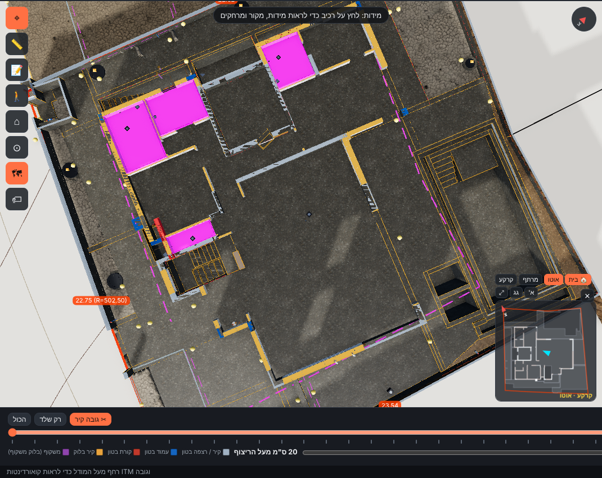
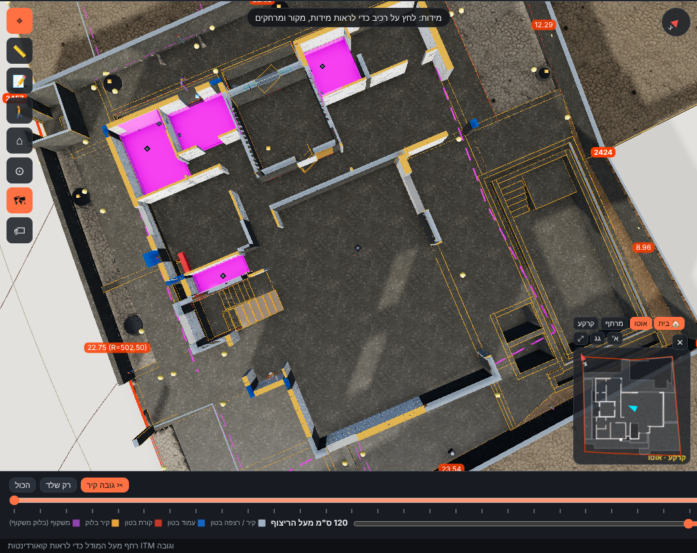
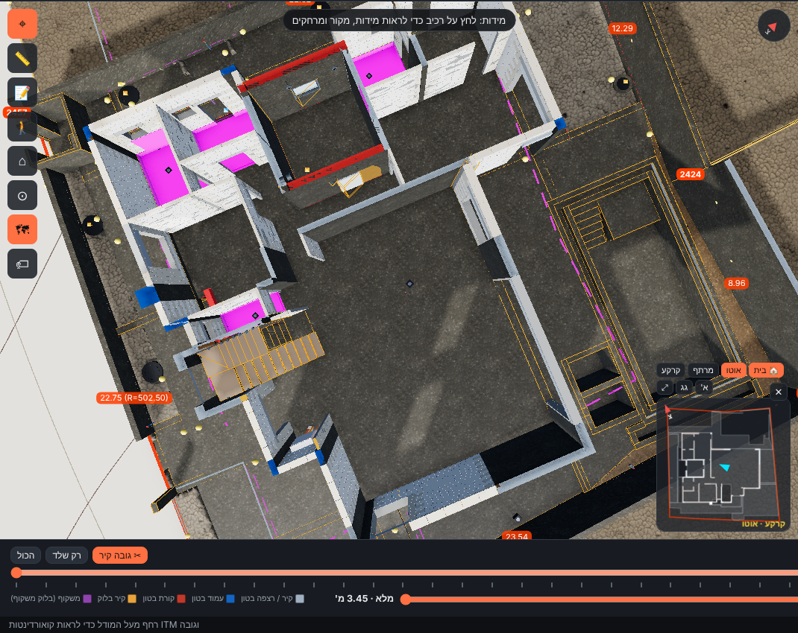

# מילוי חתך + "גובה קיר" בסרגל השלבים (13.11.2026)

בקשת אביחי: במבט על בחתך קומה – קיר מלא מלמעלה (לא חלול), סימון שונה לקורה ולקיר בלוק, וסרגל לגובה הקיר מ-20 ס"מ מעל הריצוף ועד הגובה המלא.

## מה נעשה
- **מילוי חתך** (`js/tools/section.js`): כל אלמנט מוצק מהסוגים ב-`data/config/display.json → sectionCut.caps` מקבל "תאום" שמצייר רק את הפאות האחוריות בצבע אחיד. במקום שמישור החתך פותח את האלמנט רואים את הפנים בצבע מלא. אלמנט שלא נחתך – ללא שינוי. התאומים קיימים רק אחרי הפעלת חתך, לא מטילים צל ולא נבחרים בלחיצה. כיבוי: תצוגה ← חתך ← "מילוי חתך".
- **צבע לפי סוג:** קיר / רצפה בטון – אפור-כחלחל `#9fb0c2` · עמוד בטון – כחול `#1565c0` · קורת בטון – אדום `#c0392b` · קיר בלוק – כתום `#e8a33d` · משקוף – סגול `#8e44ad`. מקרא בסרגל השלבים ובלשונית החתך.
- **"✂ גובה קיר"** בסרגל השלבים: מפעיל חתך אופקי של קומה; שורה שנייה – בחירת קומה + סרגל גובה מעל הריצוף (‎`tags.json floors[].level`) מ-0.20 מ' ועד "מלא". "מלא" = תחתית תקרת הקומה (נמדד מהמודל), 1 מ"מ מתחתיה – כך התקרה שמעל נחתכת והקירות נראים מלאים בגובה המלא. בגג (אין תקרה) – ראש הקירות.

## אימות (מהמודל, בדיקת דפדפן)
| קומה | מפלס ריצוף | "מלא" במודל | מקור |
|---|---|---|---|
| יחידת דיור | ‎−2.60 | ‎−0.40 (תחתית רצפת הקרקע) | רצפת הקרקע K-21: ‎−0.40…−0.15 |
| קרקע | ±0.00 | ‎+3.45 (גובה קיר 3.45) | תקרה K-31: תחתית ‎+3.45 (חלק ‎+3.50), עליון ‎+3.70 |
| קומה א' | ‎+3.70 | ‎+6.65 (2.95 מ') | תקרת הגג K-41: ‎+6.65…+6.90 |
| גג | ‎+6.90 | ‎+8.00 (1.10 מ') | ראש קירות / קורות הגג ‎+8.00 |

סרגל בקרקע: 0.20 → hLevel ‎+0.200 · 1.20 → ‎+1.200 · מלא → ‎+3.449. `npm test` עובר (מחשב + טלפון, 0 שגיאות קונסול); בדיקת smoke חדשה: תאומי מילוי נוצרים ומוצגים עם החתך, שורת "גובה קיר" מופיעה.

