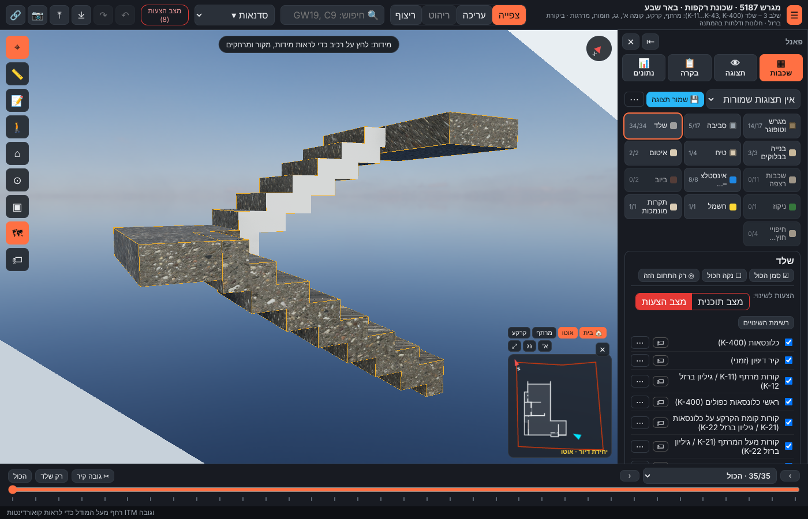
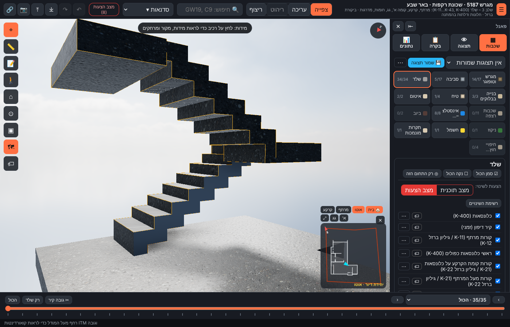

# מדרגות ירידה ליחידת הדיור ST1 (מרתף ← קרקע) – תכנון מחדש (13.11.2026)

**הערות אביחי:**
- "יש מדרגה מעל הריצוף של היחידה."
- "המפלס של הפודסט לא סימטרי עם המדרגות."
- "תמדל ותתכנן מחדש."
- "תעשה טיח בצדדים של המדרגות."

## מה היה לא נכון
- **מדרכים בגובה הבטון:** הגרם נמדד ממפלסי הבטון (‎-2.75 → ‎-0.15), והנחנו שיהיה חיפוי של 15 ס"מ על המדרכים.
- **רום ראשון קצר:** בלי חיפוי, מדרך 1 יצא 2.3 ס"מ מעל ריצוף היחידה ‎-2.60, ולא 17.3 ס"מ. זו ה"מדרגה מעל הריצוף".
- **רום אחרון גבוה:** הרום האחרון אל ±0.00 יצא 32 ס"מ.
- **פודסט לא בקו:** פודסט הביניים היה ב-‎-1.363, ‏15 ס"מ מתחת לקו הרומים הגמור.

## מה תוכנן
- **בלי חיפוי:** הבטון הוא המדרך הגמור.
- **15 רומים שווים של 17.3 ס"מ:** מריצוף היחידה ‎-2.60 עד ריצוף הקרקע ±0.00.
- **רום 1:** עומד על רצפת המרתף ‎-2.75. המילוי והריצוף (15 ס"מ) צמודים אליו, כך שהרום הנראה הוא 17.3 ס"מ.
- **פודסט ביניים:** ‎-1.213, בדיוק בגובה רום 8. עובי 28 ס"מ (נמדד בחתך א-א).
- **רום 15:** מגיע לרצפת הקרקע ‎-0.15. מעליה 15 ס"מ ריצוף, עד ±0.00.
- **גרם מקופל, כמו ST2:** התחתית מדורגת. עובי הלוח 20 ס"מ (נמדד בחתך א-א, approx).
- **טיח פנים על הצד החשוף של כל שלח:** ST1-A – 0.69 מ"ר · ST1-B – 0.60 מ"ר.
  - בין שני השלחים יש מרווח של כ-9 ס"מ, שנראה מהיחידה. הצדדים האחרים יצוקים צמוד לקירות המרתף.
  - הטיח בשכבה "טיח פנים", שכבויה כברירת מחדל.

## טבלת אימות
| מידה | מקור | במודל | סטייה |
|---|---|---|---|
| רומים | ‎-2.60 → ±0.00 = 15 רומים | 15 × 17.3 | 0 |
| רום ראשון (ריצוף ‎-2.60 → מדרך 1) | 17.3 | 17.3 (היה 2.3) | 0 |
| רום אחרון (מדרך 14 → ריצוף ±0.00) | 17.3 | 17.3 | 0 |
| פודסט ביניים | ‎-2.60 + 8 × 0.1733 | ‎-1.213 (היה ‎-1.363) | 0 |
| תחתית | K-11 BS1 O.K ‎-2.75 | ‎-2.75 | 0 |
| הגעה | K-21 GS1 O.K ‎-0.15 | ‎-0.15 | 0 |
| שלח / רוחב | תוכנית מרתף / קרקע 1:50 | 27.4 / 27.7 · 88.5 / 88.1 | — |
| עובי הלוח / הפודסט | חתך א-א 1:100 (approx) | 20 / 28 | approx |
| נפח בטון | נגזר | ‎≈2.05 מ"ק (היה 1.85) | — |
