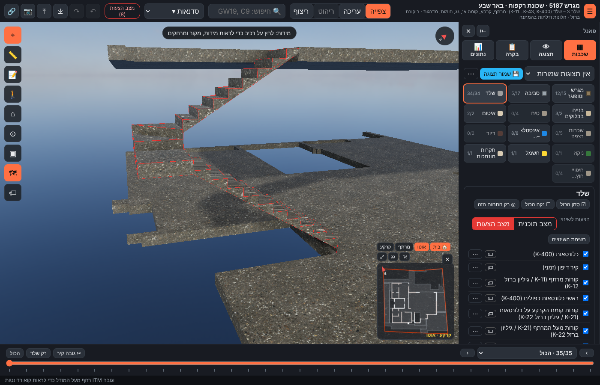
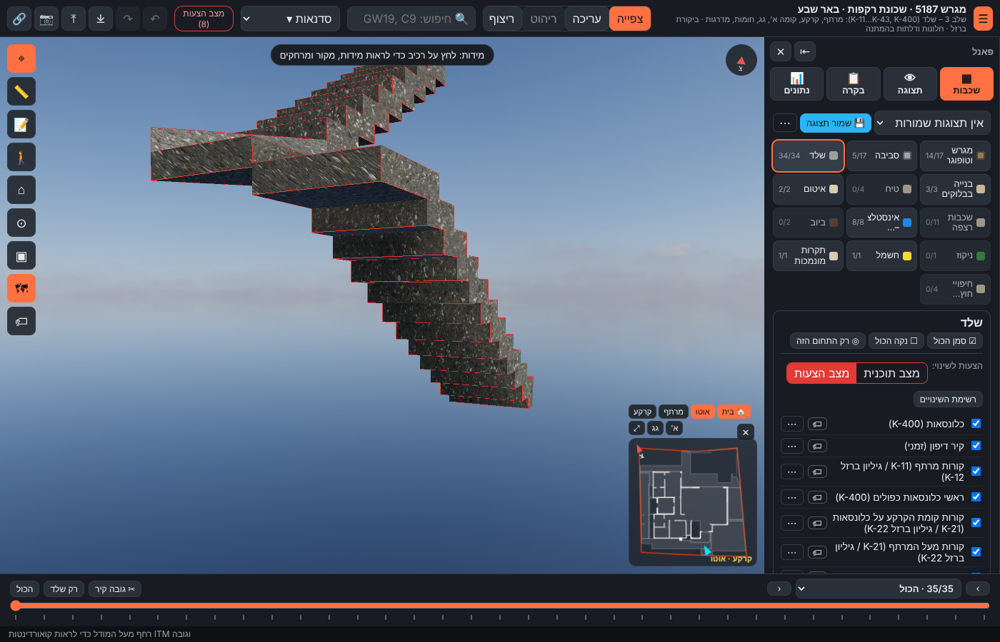
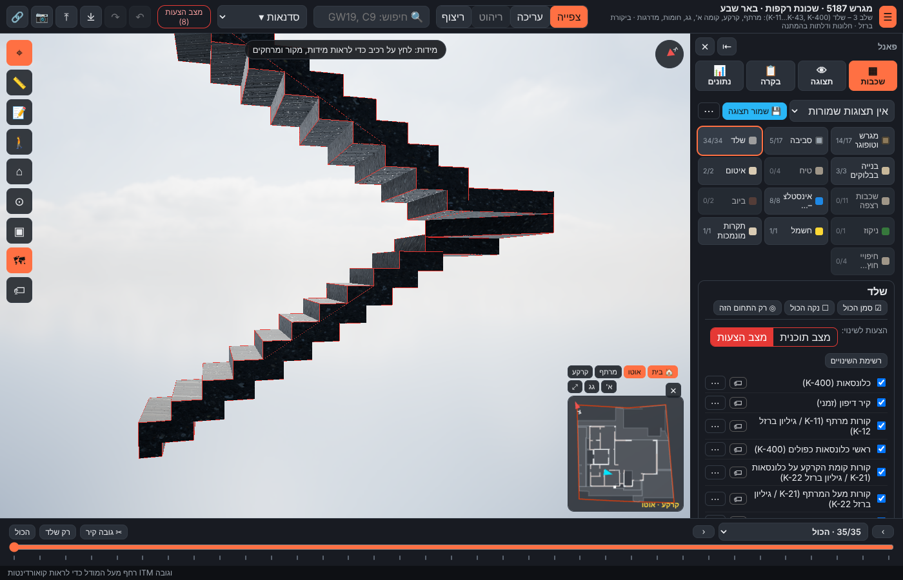

# גרם מדרגות בטון ST2 (קרקע ← א') – הצעה OC-3, תכנון מחדש (13.11.2026)

**הערות אביחי:**
- (סבב 2) "רציתי מדרגות מדורגות גם בצד האלכסון" → גרם **מקופל**: התחתית מדורגת במקביל למדרכים.
- "המדרגות לא מתוכננות נכון."
- "המדרגה האחרונה לא יושבת לפי התקן על רצפת הקרקע."
- "אין חיפוי."

## מה היה לא נכון
1. **הנחת חיפוי של 15 ס"מ:** כל מדרך הונמך ב-15 ס"מ. כתוצאה מכך הרום הראשון מעל הריצוף ±0.00 יצא **2.5 ס"מ**, והרום האחרון אל ריצוף קומה א' +3.85 יצא **32.5 ס"מ**.
2. **אין תחתית רציפה:** כל מדרך היה בלוק נפרד בגובה רום + 20 ס"מ. התחתית יצאה מדורגת ו"מרחפת", ולא היה שלח עם תחתית משופעת.

## מה תוכנן
- **בלי חיפוי:** הבטון הוא המדרך הגמור. מדרך n נמצא בגובה n × 17.5 ס"מ מעל ±0.00.
- **גרם מקופל:** לוח בעובי אחיד של 20 ס"מ (זמני) מתחת לכל מדרך ומאחורי כל רום. התחתית מדורגת במקביל למדרגות, גם במדרכי הפנייה 26–28.
- **שלח A (16–25):** רום 16 עומד על רצפת הקרקע ‎-0.15. המילוי והריצוף (15 ס"מ) צמודים אליו, כך שהרום הנראה הוא 17.5 ס"מ.
- **שלח B (29–36):** יוצא מלוח מדרך הפנייה 28. הלוח של מדרך 36 נכנס 20 ס"מ לשפת תקרת הקרקע FS1 (+3.70).

## טבלת אימות
| מידה | מקור | במודל | סטייה |
|---|---|---|---|
| רומים | חתך א-א: 0 → 385 = 22 רומים | 22 × 17.5 | 0 |
| רום ראשון (ריצוף ±0.00 → מדרך 16) | 17.5 | 17.5 (היה 2.5) | 0 |
| רום אחרון (מדרך 36 → ריצוף +3.85) | 17.5 | 17.5 (היה 32.5) | 0 |
| שלח | תוכנית קרקע 1:50 | 28.0 / 28.1 | — |
| 2R + G | — | 63.0 ס"מ | — |
| רוחב שלח | תוכנית קרקע | 92.3 / 91.5 | — |
| תחתית הגרם | K-21 GS1 O.K ‎-0.15 | ‎-0.15 | 0 |
| הגעה | K-31 FS1 +3.70 | +3.70 | 0 |
| עובי הלוח המקופל | **אין מקור** (זמני) | 20 | provisional |
| תחתית | הערת אביחי | מדורגת | — |
| נפח בטון | נגזר | ‎≈1.89 מ"ק | — |

## פתוח
ראו את סעיף #195 בקובץ `docs/open-issues.md`: עיבוד שפת רום 37 בלי חיפוי, מדרכי פנייה, עובי וזיון.
