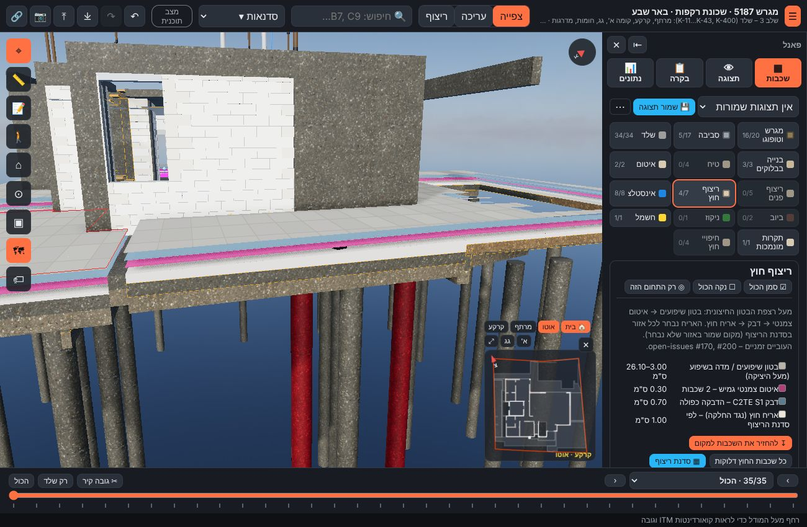

# שכבות ריצוף – פנים וחוץ (14.11.2026)

**בקשת אביחי:** "בריצוף חוץ אני לא מצליח להשתמש בשכבות לכיבוי והדלקה. לא רואים את הסומסום, הטיט והדבק של האריחים וגם את עובי האריחים. תעשה קטגוריה של ריצוף חוץ כשכבה, וריצוף פנים לשכבות נפרדות."

## מה נמצא
- הכיבוי וההדלקה עבדו, אבל לא היה אפשר להבחין בתוצאה:
  - הדבק (‎#7d7d78) והטיט (‎#a3a39e) היו כמעט באותו אפור.
  - אריח "מקום שמור" היה שקוף ב-88%.
  - השכבות דקות (3 עד 10 מ"מ) וצמודות זו לזו, ולכן העובי שלהן לא נראה.
- כל השכבות ישבו בקטגוריה אחת, "שכבות רצפה" (12 שכבות: פנים, חוץ ובריכה מעורבבים).

## מה שונה
| נושא | לפני | אחרי |
|---|---|---|
| קטגוריות | "שכבות רצפה" (12) | **ריצוף פנים** (5): סומסום, טיט / מדה, דבק, אריחים, שמות חדרים · **ריצוף חוץ** (7): בטון שיפועים, איטום, דבק, אריחים, מכסי חדר המכונות, ריצוף בריכה, קופינג |
| צבע טיט / מדה | ‎#a3a39e (אפור) | ‎#b3a68c (חולי) |
| צבע דבק (פנים וחוץ) | ‎#7d7d78 (אפור) | ‎#5e7c8f (אפור-כחלחל) |
| אריח מקום שמור | לבן, אטימות 0.12 | ‎#ece6da, אטימות 0.55 (`display.json` → `finishes.tilePlaceholder*`) |
| הרחקת שכבות | – | כפתור "↥ הרחקת שכבות" בכל אחת משתי הקטגוריות. כל שכבה מוגבהת ב-12 ס"מ מעל השכבה שמתחתיה (`explodeGap_m`). **תצוגה בלבד**, עם אזהרה בפאנל. בכיבוי השכבות חוזרות למקום האמיתי. מכסי חדר המכונות לא זזים, כי הם מסתובבים עם המכסה. |
| טבלה בפאנל | – | צבע ועובי לכל שכבה (בבטון השיפועים: טווח העובי) |

הצבעים הם צבעי תצוגה בלבד. אין שינוי במידות, בעוביים או בכמויות. מזהי השכבות לא השתנו, ולכן תצוגות שמורות ממשיכות לעבוד.

## אימות
- בדיקה headless: כיבוי שכבה אחרי שכבה ב-GS6 מראה בכל פעם את השכבה שמתחתיה (אריח ← דבק כחלחל ← איטום מגנטה ← בטון שיפועים ← רצפת הבטון).
- הרחקת שכבות בחוץ (GS6 / GS4):

- `npm test` עובר.

## המשך: "דלוק ולא רואים" (14.11.2026)
בצילום של אביחי מהטאבלט אין קרקע בכלל, ולכן קומת **"מגרש וסביבה"** כנראה מוסתרת (בלשונית הקומות או בתצוגה שמורה). שכבות הגינה (מילוי, מצע, דשא) שייכות לקומה הזו, ולכן לא הוצגו למרות שהיו מסומנות. הקוד שבארטיפקט זהה לקוד שב-main.

**תיקון כללי בפאנל השכבות:** שכבה מסומנת שאף רכיב שלה לא נראה מקבלת הודעה, אחת לכל סיבה ובראש הרשימה. לדוגמה: "⚠ 15 שכבות דלוקות אבל לא נראות: הקומה 'מגרש וסביבה' מוסתרת", עם כפתור **"להציג"**. הסיבות שנבדקות:
- הקומה מוסתרת
- סרגל השלבים נמצא לפני שלב השכבה
- מסנן מערכות פעיל

כשמסמנים שכבה כזו, התיקון נעשה אוטומטית ומופיעה הודעה קצרה.

בדיקה headless: הסתרת "מגרש וסביבה" → מופיעה הודעה → "להציג" → הגינה נראית וההודעה נעלמת.
