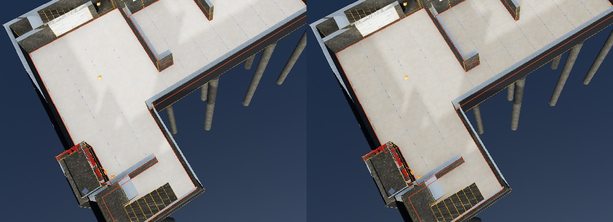

# אימות – סדנת ריצוף ושכבות הרצפה (13.11.2026)

**מה נבנה:** מצב "ריצוף" (סרגל עליון) / "סדנאות ← ריצוף" / "נתונים ← סדנת ריצוף". לכל אזור (רצפת חדר מ-`data/finishes/tiling/surfaces.json`) בוחרים אריח: מידה (קטלוג או מידה אחרת), גימור, דוגמה (ישר / הזחה 1/2 / 1/3 / אלכסון), כיוון (לאורך הקיר הארוך / 90°), נקודת התחלה (אריח במרכז / פוגה במרכז / אריח שלם מהפינה), פוגה, הזזה בס"מ, רזרבה. הפריסה מוצגת בתוכנית בפאנל (גרירה = הזזה) ובמודל על שכבת האריח, עם סימון חיתוכים צרים. **"⚡ פריסה מושלמת"** מחפשת את ההזזה (רשת 24×24 על מודול אריח אחד + עידון) עם הכי מעט חיתוכים צרים מ-5 ס"מ, אחר כך הכי מעט מתחת לשליש אריח, אחר כך הכי מעט חיתוכים.

**שכבות הרצפה (קיימות מ-11.11, עודכנו):** יציקה → **מילוי סומסום וחול** (השארית) → טיט / מדה 4 ס"מ → דבק 0.5 ס"מ → אריח 1 ס"מ. כל העוביים זמניים (#163). **המילוי מוצג בטקסטורת אבנים קטנות** (Poly Haven gravel_stones, CC0, מפת הצבע הובהרה לבז') – כדי לזהות אותו בחתך / במבט פנימי (`data/materials/materials.json` → floorFillSumsum).

**קוד:** `src/tiling/layout.js` (מנוע פריסה טהור – חיתוך כל אריח בפוליגון האזור), `src/tiling/workshop.js` (סדנה: בחירה, תלת-ממד, תוכנית, כמויות, ייצוא). **נתונים:** `data/finishes/tiling/catalog.json` (אפשרויות + מקדמי צריכה זמניים), `layout.json` (בחירות שנשמרו בריפו). הבחירות החיות – במסד הארטיפקט, collection `tiling`.

## תצוגה (13.11.2026, תיקון)

- **הפוגות מצוירות בשיידר** לפי המיקום בתוך כל אריח: ברוחב האמיתי מקרוב, ולפחות פיקסל אחד מכל מרחק וזווית. הן נעלמות בהדרגה רק כשאריח קטן מכ-12 פיקסלים במסך.
- **מישור הרובה** הורד אל פני הדבק (במקום 3 מ"מ מתחת לפני האריח). זה תיקון למצב שבו מרחוק הרובה "ניצח" את האריח בעומק, והרצפה נראתה כמשטח אפור אחיד בלי האריח שנבחר.
- **מרחוק / מזווית:** שכבות הרצפה (דבק, מדה) ומישור הרובה היו עם הסטת עומק (polygon offset) חזקה מהאריח, ומרחוק הן "ניצחו" אותו – הרצפה נראתה אפורה. הוסר. הפוגות מחושבות לכל כיוון בנפרד ומחוץ לענף בשיידר (נגזרות).
- **בלי רווח אמיתי בין האריחים בתצוגה (13.11):** פוגה של 2 מ"מ צרה מפיקסל, והשכבה שמתחתיה נראתה דרכה כנקודות. כל אריח מצויר עד קו האמצע של הפוגה, והפוגה נצבעת בצבע הרובה בשיידר – קו רציף וחד, ברוחב האמיתי מקרוב ולפחות פיקסל אחד מרחוק. הכמויות לא השתנו (נספרות לפי האריח האמיתי).
- **"▦ הצג חלוקה במודל" (13.11):** כפתור בסדנה – כל הפוגות בצבע בולט (אדום) ובעובי של כשני פיקסלים, בלי דהייה מרחוק, בלי קשר לצבע הרובה. לחיצה נוספת – המראה האמיתי. נשמר בדפדפן.
- **רובה:** צבע רובה לכל אזור (לבן / אפור בהיר / אפור / בז' / חום עץ / אנתרציט), ברירת מחדל לפי הגימור. הפוגה מצוירת בצבע הרובה, בגובה האריח.
- **טקסטורות:** דמוי עץ – Poly Haven oak_veneer_01 (הסיבים לאורך האריח), דמוי בטון – concrete_floor_01 עם מפות normal / roughness; שאר הגימורים – צבע עם גיוון בין אריחים.

## בדיקה: פריסת 60×60, פוגה 2 מ"מ, אריח במרכז, לפני ואחרי "פריסה מושלמת"

שטח האזור במודל = שטח פוליגון האזור; שטח האריחים = סכום החתיכות; פוגות = (שטח − אריחים)/שטח. תיאורטית ל-60×60 ופוגה 2 מ"מ: ‎1 − 0.6²/0.602² = 0.66%.

| קומה | אזור | שטח בנתונים מ"ר | שטח בפריסה | סטייה | אריחים מ"ר | פוגות | כיוון הקיר | צרים / מתחת לשליש – לפני | הזזה ס"מ | אחרי | חיתוך מינ' ס"מ | שלמים+חתוכים | להזמנה (אריחים / קרטונים) |
|---|---|---|---|---|---|---|---|---|---|---|---|---|---|
| יחידת דיור | אחסנה בלבד / ירידת קירות ממ / מרתף שירות | 85.165 | 85.143 | -0.022 | 84.597 | 0.64% | 68.02° | 1 / 5 | -3.7 / -5.6 | 0 / 0 | 20.1 | 168+102 | 300 / 75 |
| קרקע | ממ | 11.091 | 11.092 | 0.001 | 11.020 | 0.65% | 68.02° | 0 / 24 | 17 / 15.1 | 0 / 0 | 32.0 | 20+16 | 41 / 11 |
| קרקע | אוכל / אורחים / חלל עולה / מטבח / סלון | 87.674 | 87.683 | 0.009 | 87.120 | 0.64% | 68.01° | 6 / 29 | 11.2 / 9.4 | 0 / 0 | 22.1 | 179+89 | 293 / 74 |
| קרקע | יחידת הורים | 24.636 | 24.638 | 0.002 | 24.483 | 0.63% | 68.01° | 0 / 19 | 5 / -17 | 0 / 0 | 20.7 | 44+34 | 88 / 22 |
| קרקע | שירותים (לפי כלים בתוכנית האינסטלציה) | 2.058 | 2.058 | 0.000 | 2.048 | 0.48% | 67.99° | 0 / 10 | 27.6 / 14.4 | 0 / 0 | 28.3 | 0+8 | 9 / 3 |
| קרקע | שינה | 12.451 | 12.450 | -0.001 | 12.374 | 0.61% | 68.01° | 0 / 2 | 0 / 27 | 0 / 0 | 26.0 | 19+22 | 47 / 12 |
| קרקע | חדר רחצה (לפי כלים בתוכנית האינסטלציה) | 4.688 | 4.688 | 0.000 | 4.662 | 0.56% | 68.09° | 0 / 10 | 10.6 / 27.6 | 0 / 0 | 20.1 | 4+12 | 17 / 5 |
| קרקע | כביסה | 5.399 | 5.399 | 0.000 | 5.367 | 0.60% | 68.01° | 0 / 10 | 0 / 11.9 | 0 / 0 | 23.4 | 6+14 | 21 / 6 |
| קרקע | רחצה | 6.842 | 6.841 | -0.001 | 6.799 | 0.62% | 68.01° | 0 / 20 | 18.8 / 14.4 | 0 / 0 | 20.6 | 12+12 | 26 / 7 |
| קומה א' | חדר | 20.963 | 20.966 | 0.003 | 20.825 | 0.67% | 68.02° | 0 / 11 | 0 / 10.6 | 0 / 0 | 20.6 | 42+33 | 84 / 21 |
| קומה א' | חדר | 21.144 | 21.142 | -0.002 | 21.004 | 0.65% | 68.01° | 4 / 13 | 1.2 / 11.2 | 0 / 0 | 20.4 | 39+38 | 87 / 22 |
| קומה א' | חדר רחצה (לפי כלים בתוכנית האינסטלציה) | 8.131 | 8.128 | -0.003 | 8.080 | 0.59% | 68.00° | 1 / 13 | 0 / 10.6 | 0 / 0 | 20.2 | 10+18 | 30 / 8 |

- **סטייה בשטח:** עד 0.009 מ"ר, חוץ מהמרתף (‎−0.022 מ"ר = 0.03%, עיגול הפוליגון מול סכום החלקים בגזירה). בתוך הסובלנות של הבדיקה (0.05%).
- **פוגות:** 0.48%–0.67% – תואם לחישוב התיאורטי (חדרים קטנים – פחות פוגות לכל מ"ר בגלל חיתוכים בשוליים).
- **כיוון:** כל האזורים יוצאים 68.0° (±0.1°) – כיוון קירות הבית ברשת ITM. האריחים מקבילים לקירות.
- **פריסה מושלמת:** 12 חיתוכים צרים מ-5 ס"מ ו-166 מתחת לשליש אריח → 0 / 0 בכל האזורים (60×60). החיתוך הקטן ביותר אחרי: 20.1 ס"מ.
- **להזמנה** = (שלמים + חתוכים + אריחים לפנלים) × (1 + רזרבה 5%), מעוגל מעלה לקרטונים. כל חתיכה נספרת כאריח (בלי שימוש חוזר בשאריות).

## מוצר אמיתי: AT12625 – Atlas Concorde Boost Icor Dust 120×120 (13.11.2026)

מקור: דף המוצר באתר נגב (`boost_icor-2025`), הפרטים שאביחי העתיק לצ'אט. בסדנה: "מוצר:" → AT12625 קובע מידה, עובי, אריחים בקרטון וגימור.

| נתון | מקור (הספק) | במודל | סטייה |
|---|---|---|---|
| מידה | 120/120 ס"מ | 1.200 × 1.200 מ' | 0 |
| עובי | 9 מ"מ | 0.009 מ' | 0 |
| כמות בחבילה | 2.88 מ"ר | 2 אריחים × 1.44 = 2.880 מ"ר | 0 |
| גימור | מט, R10, V3 | חספוס 0.75, גיוון בין אריחים 0.08 | מראה בלבד |
| גוון / מראה | DUST – 3 תמונות פנים בדף המוצר (V3) | טקסטורה: אטלס 3 הפנים (`assets/textures/at12625/faces.webp`), כל אריח מקבל פנים אחד. ממוצע ‎#cec3b2 = (206,195,178) | תמונת הספק |
| גוון מוצג (מבט מלמעלה, אחרי תיקון התאורה) | (206,195,178) | (210,205,196) | +4 / +10 / +18 – מעט בהיר ופחות רווי (ACES) |

### למה הבהירים נראו לבנים – ותיקון התאורה

במבט מלמעלה התקרה מוסתרת, ולכן הרצפה מקבלת שמש ישירה (3.2) ואת אור השמיים הכחולים של ה-HDRI (0.9). שני אלה מבהירים את הגוון ומשטיפים אותו לאפור-לבן (ACES). לפני התיקון: (224,221,217), אפור-לבן בלי גוון בז'. התיקון חל על האריחים בלבד, וכל הערכים ב-`data/config/display.json` → `tiling`:
- `interiorSun` 0.6: חלק השמש הישירה.
- `neutralAmbient` 1: אור מפוזר ניטרלי, כמו מתקרה וקירות לבנים, במקום הכחול של השמיים.
- `ambientScale` 0.7: עוצמת האור המפוזר.

כלי חוזר: `python3 tools/finishes/fetch_product.py <url> <SKU>` מוריד את תמונות המוצר מהדף אל `sources/products/<SKU>/` ובונה את האטלס.

בדיקה אוטומטית: `tests/tiling.mjs` בוחר את המוצר באזור ומוודא שהמידה, העובי ו-2.88 מ"ר בקרטון תואמים לקטלוג.

## בדיקה אוטומטית (`node tests/tiling.mjs`, חלק מ-`npm test`)

מחשב + טלפון headless: כניסה למצב ריצוף פותחת את הסדנה ומדליקה את שכבת האריח; 60×60 לכל 12 האזורים + "פריסה מושלמת"; שטח הפריסה = שטח האזור; שטח האריחים בין 97% ל-100% מהאזור; האופטימיזציה אף פעם לא מחמירה; 12 רכיבי ריצוף במודל ו-0 "מקום שמור"; ייצוא xlsx תקין (3 גיליונות: אזורים, הזמנה, שכבות רצפה); אין שגיאות בקונסול.

## פתוח

- #178 – מקדמי צריכה (דבק, רובה, אריחים בקרטון, גובה פנל) – זמניים, לפי היצרן.
- #179 – אזור "אוכל / אורחים / חלל עולה / מטבח / סלון" הוא אזור אחד (87.7 מ"ר). לריצוף שונה במטבח – צריך קו חלוקה.
- #163 – עוביי השכבות (פרט רצפה).
- ריצוף חוץ (אזורים, שיפועים ושכבות): [exterior-paving.md](exterior-paving.md).
